# When the Container Is the Benchmark: A Bit-Exact Native Reimplementation of the ABIDES Market Simulator and What Whole-Container Timing Rewards

**Technical report — Agenthon 2026, Track 3 (Accelerated Market Simulation)**

**Team:** S2WISH (team 36) · **Version:** 1.3 · **Status of results:** Development phase (practice board); the Final had not been run when this was written

**Author:** Shashwat Srivastava ([ORCID 0009-0000-0033-5570](https://orcid.org/0009-0000-0033-5570)) · **Affiliation:** Independent Researcher

---

## Abstract

Agenthon 2026 Track 3 asks participants to make the ABIDES agent-based market simulator faster while reproducing its outputs exactly: the order-event trace and the message ledger of every scenario must equal the reference. We built a C++ engine that reproduces ABIDES event for event and numpy's legacy random streams draw for draw, and verified it on the 65 public scenarios, 30 batch sub-scenarios and 1,318 stored differential-fuzz cases with recorded reference hashes.

Partway through the Development phase the organizers changed the ranked quantity from a self-reported simulation-loop rate to **verified events divided by whole-container time measured by their harness**, averaged over units. This report documents how that change relocated the optimisation problem. Under the old rule our engine reported 8.34 million events/s; under the new one the same engine, packaged the same way, scored 153,825 — and profiling showed the event loop was 7–15% of each unit's process time while Parquet encoding through Apache Arrow was 50–63%. Replacing Arrow with a purpose-built Parquet writer of about 300 lines, a built-in SHA-256 and a static launcher cut total process time over the 65 public units from 10.20 s to 3.41 s on our machine and raised the score to 181,496. Shipping the same program as a 2.2 MB single-layer image raised it only to 184,858; leaving out an output the scorer does not read on six heavy units, to 188,687; a profile-guided build, to 189,018. Building the trace in its final order during the run, which removes three passes over the data after it, raised the score to **203,394**, our best at the time of writing: rank 10 of 50 teams, when the first three stood at 231,024, 222,058 and 221,088. Several other uploads scored below the best at the time.

The main finding is about measurement, and it is not flattering. Our laptop timings predicted the wrong sign of a host score several times. A two-parameter cost model fitted to our first two scores was refuted by the leader's score, and no model of the form "fixed cost plus a multiple of laptop process time" can even rank our own builds. After the organizers stated that Development runs on a single dedicated machine, and another team reported that two runs agree to within 0.1%, uploads that change one setting became the only instrument we trust. Five of them gave the cleanest measurement of the project (the helper thread that produces latency draws ahead of the event loop is worth 9.5% on the host: 203,394 against 185,818 for the same binary) and overturned two conclusions we had announced hours earlier ("writer threads lose", "threads lose"). A sixth showed that the helper's gain does not carry over to our faster engine: the same helper code is worth 2.6% there, and the combination scored 2.1% below our best. One build that bundled a speculative change with a measured optimisation scored 3.6% below its predecessor and took two further uploads to untangle; the mechanism is still not established. We report what was measured, what was only modelled, the hypotheses that were refuted (including our own score predictions), the experiments that failed, and the limits of a study whose timing rig was a memory-starved laptop. Everything needed to reproduce the correctness results is included.

**Keywords:** discrete-event simulation; limit order book; ABIDES; bit-exact reproduction; benchmark design; container start-up latency; Parquet; differential fuzzing

---

## 1. Summary of findings

| # | Finding | Evidence | Status |
|---|---|---|---|
| 1 | A native engine can reproduce ABIDES exactly, including numpy `RandomState` streams | Byte-identical trace and ledger on 65 scenarios and 30 batch sub-scenarios; 1,318 of 1,318 fuzz cases reproduce the recorded reference hashes | Measured |
| 2 | Under whole-container timing the simulator stops being the bottleneck | Event loop 7–15% of process time; Parquet encoding 50–63% (10 units, best of 5) | Measured |
| 3 | A purpose-built Parquet writer is worth more than the engine | Process time 10.20 s → 3.41 s over 65 units; score 153,825 → 181,496 (+18%) | Measured |
| 4 | Image shape (773 MB Python-based vs 2.2 MB scratch) is a minor factor on the scoring host | 181,496 → 184,858 (+1.9%), with a slightly faster binary included in that step | Measured (one run each) |
| 5 | The fixed container cost is at most 0.47 s per unit. Our earlier fit of 0.55 s was wrong | 7,728,572 events over 71 units and the leader's 231,024 | Arithmetic bound |
| 6 | On the laptop, memory handling dominates what remains; on the scoring host it does not | Laptop: kernel time ≈ user time, 367K → 125K page faults, −23% process time. Host: 184,858 → 183,420 (−0.8%) | Measured; the host result is one run |
| 7 | Work the scorer never reads is the cheapest gain | Six units' cards say no message ledger is required; not producing it scored 183,420 → 188,687 (+2.9%) | Measured (one run each) |
| 8 | Laptop timing is a poor proxy for the scoring host, in sign as well as size | Fresh containers are 2–5× slower on the laptop with a spread as large as the mean; of nine steps with both a laptop figure and a host score, four had opposite signs (§5.9, §5.10) | Measured |
| 9 | A build that bundled five changes scored 2.6% lower and the cause could not be isolated | sub11 189,018 → sub13 184,047 | Measured (one run each); unexplained |
| 10 | A cautious launcher can be silently slow | It declined 73% of fuzz inputs for a formatting reason; 1.7% after the fix | Measured |
| 11 | A validation that only reports pass or fail can hide a lost code path | A later build still passed 1,318 of 1,318 fuzz cases, but 29 of them had moved to the reference path | Measured |
| 12 | Building the trace in its final order during the run is the largest gain since the writer | sub11 189,018 → sub16 203,394 (+7.6%); the laptop had suggested 4–7% less process time | Measured (one run each); sub16 also carries two smaller changes (§5.8) |
| 13 | The latency helper thread is worth 9.5% on the host on sub16's engine, and 2.6% on sub18's faster engine | The sub16 binary scored 203,394 with it and 185,818 with one environment variable switching it off; sub18's engine scored 193,962 without a helper and 199,058 with sub16's helper code (sub19a) | Measured (one run each). The first pair is one binary, one environment variable apart; the second is two builds |
| 14 | A bundled, unmeasured change can cost more than the measured one gains | sub17 = sub16 + a branch-free heap step (measured: 56–57% fewer branch misses on the largest unit) + a changed helper start-up (not measured): 196,165, 3.6% below sub16 | Measured; cause assigned by elimination, mechanism not established |
| 15 | Writer threads during the run are a small gain, not a loss | Same sub17 binary: 196,165 without, 199,285 with (+1.6%) | Measured (one run each); contradicts our reading of finding 9 |
| 16 | No cost model built on laptop time ranks our own builds | Best fit of "fixed cost + k × laptop process time": rms residual 3.2%, largest 6.3%; three score projections from it all missed | Modelled, then refuted by scores |
| 17 | Hardware counters repeat where wall-clock time does not | Instructions to ±0.00%, branch misses to under 0.5%, cycles to 0.5–2%; laptop process-time ratios for the same pair of builds were −14% in one session and −3% in another | Measured |

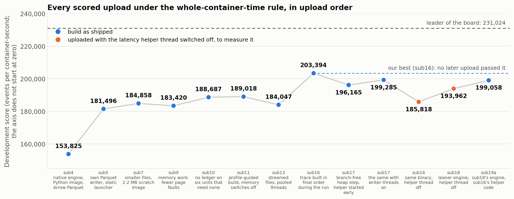

*Figure 1. Development scores of every scored upload under the whole-container rule, in upload order, from sub4 to sub19a (a second upload of the sub4 image is left out). Blue: a build as shipped; orange: the two uploads made with the latency helper thread switched off in order to measure it. The vertical axis does not start at zero. sub16 (203,394) remains our best: the five uploads after it, sub19a (199,058) included, scored below it; they are compared in Figure 16. Each score is a single run per unit. Two uploads of the same sub4 image differed by 1.6%; the organizers later stated that the Development host is a single dedicated machine, and another team reported repeatability of 0.1% (§4.2).*

---

## 2. The task

### 2.1 What must be reproduced

ABIDES (Agent-Based Interactive Discrete Event Simulation, `jpmorganchase/abides-jpmc-public`, commit `f9cbe513`) simulates a limit-order-book exchange and a population of trading agents exchanging timestamped messages through a kernel. A scenario fixes the seed, the horizon, the agent population (noise, value, momentum and market-maker agents), an oracle (a mean-reverting fundamental with jump "megashocks"), a latency model (deterministic, uniform, log-normal or Pareto) and exchange options (self-trade prevention, acknowledgement and computation delays).

A submission is a Docker image exposing two commands:

- `simulate --config scenario.json --out trace.parquet` writes three files: the trace (7 columns: time, agent, event type, side, price, size, order id), the message ledger (10 columns, three of them nullable) and `events.json` (counts, hashes, timing). On units whose card declares that no ledger is required, the ledger may be left out (§5.9);
- `simulate-batch --batch-dir … --out-dir …` does the same for several markets and writes an aggregate.

Correctness is gated before speed counts. The gates relevant here: the trace must match the reference's fills and ordering; the ledger, where required, must be consistent with it; the event count must equal the reference's exactly on every unit; the hash declared in `events.json` must be the hash of the file written.

### 2.2 What is ranked — and how it changed

| | Before the scoring change | Since the scoring change (Development) | Final (announced) |
|---|---|---|---|
| Numerator | events | verified events (Parquet row count) | verified events |
| Denominator | simulation-loop time **reported by the submission** | container time **measured by the harness**, from creating the container to removing it | Docker `StartedAt` → `FinishedAt` |
| Runs per unit | 1 | 1; a single machine that takes only Track 3 runs, one submission at a time, its units one after another (organizers' statement) | 5, first discarded, median; at most 300 s per run and 24 hours for the whole run |
| Aggregation | mean, each unit capped at 10⁷ | arithmetic mean of per-unit rates | arithmetic mean of per-unit rates |
| Environment | — | `--cpus=4` quota, 16 GiB, no network, read-only root, uid 65534, 64 MiB noexec `/tmp`, 256 PIDs, a GPU attached to every unit | same quota; the same machine as Development (organizers' statement) |

Two properties of the new rule drive everything that follows.

1. **A mean of rates is dominated by the units with the most events.** The 71 public units (65 single scenarios and 6 batch units) contain 7,728,572 trace events; the 8 largest hold 53.5% of them (Figure 2). The 65 single scenarios alone contain 7,465,846.
2. **Every unit's denominator contains a fixed container cost** that the participant does not control.

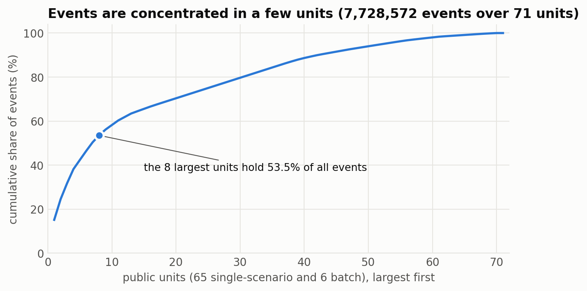

*Figure 2. Concentration of events across the 71 public units of the Development roster (65 single-scenario units and 6 batch units; 7,728,572 events).*

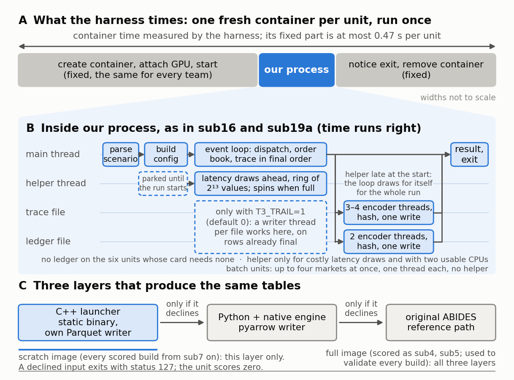

*Figure 3. (A) What the Development harness times; widths are schematic, and for a median unit our process is a small part of the measured time. (B) What the launcher does inside that window, as shipped in sub16 and restored in sub19a. The event loop puts the trace rows in their final order as it runs. A helper thread, created with the engine and parked until the event loop wakes it at the start of the run, draws latencies ahead of the loop into a ring of 2¹³ values and spins while the ring is full; if it has not overtaken the loop within the first ring of draws, the loop draws for itself for the whole run. The helper exists only for latency models with a costly draw and when two CPUs are usable; batch units run up to four markets at once without it. Output is encoded after the event loop by default (three or four encoder threads for the trace, two for the ledger, one write per file); from sub15 a switch (`T3_TRAIL=1`) instead gives each file a writer thread that works during the loop, a mode scored once (sub17 with writer threads on, §5.10). sub17 and sub18 changed the helper's start-up and waiting (§5.8) and are not what is drawn. (C) The three layers of the submission, each used only if the one before declines the input. The scratch image holds the first layer only: there a declined input exits with status 127 and the unit scores zero.*

---

## 3. System

### 3.1 Three exact layers

| Layer | Used when | Output files |
|---|---|---|
| C++ launcher (`launcher.cpp`, static binary) | The scenario uses plain JSON types inside a certified numeric domain | Valid Parquet with identical tables (sub5 onward); pyarrow's exact bytes in sub4 |
| Python + native engine (`t3native`, ctypes → `libt3engine.so`) | The launcher declines | pyarrow's exact bytes |
| Original ABIDES (`abides_fork`) | The engine declines or raises | reference bytes |

Anything a faster layer is not certain about is handed to a slower one. The launcher declines, among other cases: values outside ranges where integer and floating-point arithmetic were proven exact; an empty trace; more than 60,000 agents; a log-normal latency draw that could round differently under a different `log` implementation (§7.3); and, from sub18, a size or order id that does not fit the 32-bit fields of the compact trace row.

### 3.2 The engine

`engine.cpp` (1,503 lines in sub4; 1,662 in sub16) reimplements the kernel, the exchange and order book, the four agent types, the oracle, the latency model, the ledger and the trace row ordering. `np_random.hpp` reproduces numpy 1.26 `RandomState` (MT19937, legacy polar Gaussian, exponential, masked-rejection integers, log-normal, Pareto); it was checked on a 478-million-draw comparison matrix.

Design points that mattered for exactness:

- the kernel's dispatch order key `(deliver_at, sender, recipient, message_id)` is preserved exactly; faster data structures were accepted only when they produce the same minimum;
- every agent owns its random stream; the latency stream depends only on the draw index, which is what allows a helper thread to produce it ahead of the main loop;
- `-ffp-contract=off` everywhere: fused multiply-add would change results;
- Python's `round()` (ties to even) and `int()` (truncation) are reproduced, the latter also for whole numbers written as floats (§6.4);
- from sub14 the trace is kept in its final order while the run proceeds, which is valid because rows are logged at dispatch times that never decrease; when a negative latency breaks that, the trace is rebuilt by the reference's full rule at the end (§5.8). This is the change behind the best score (§5.10);
- every later engine change (the branch-free heap step of sub17; the compact trace row, wakeup rings and sorted blocked queues of sub18, §5.8) was accepted only after its binary produced the same bytes as the sub16 binary on the 65 single units, with the helper thread on and off (§4.1).

### 3.3 The output path

sub1–sub4 wrote Parquet through the same Arrow library pyarrow ships, with pyarrow's writer settings, which made the files byte-identical to the reference. From sub5 the launcher uses its own writer (`pq_fast.hpp`):

| Aspect | Choice |
|---|---|
| File structure | Thrift compact footer written by hand; one V1 data page per column chunk; all columns OPTIONAL, as pyarrow writes them. Row groups of at most 2²⁰ rows when the file is built after the run (sub5–sub11, and the default from sub16); 2¹⁶ in the streamed writer of sub12–sub14; 2¹² when writer threads work during the run (sub15; a switch, `T3_TRAIL=1`, from sub16) |
| Integers | PLAIN in sub5; DELTA_BINARY_PACKED from sub6 (blocks of 128 deltas, 4 miniblocks) |
| Strings (`msg_type`, `side`) | One dictionary page; RLE_DICTIONARY indices as a single bit-packed run, 4 bits per value; written from integer codes |
| Nullable columns | Definition levels as a bit-packed run of width 1; only present values stored |
| Metadata | The same `pandas` JSON as the reference (this restores nullable `Int64` dtypes) |
| Hash | Built-in SHA-256 using the CPU's SHA instructions, portable fallback |
| Compression | None; the encodings do the work |

The verifier reads the files with `pandas.read_parquet`, compares tables, and checks the declared hash against the file we wrote. It does not compare file bytes with the reference; we confirmed this by reading the public scorer and by passing the organizers' regression harness.

---

## 4. Method

### 4.1 Evidence loop

Every change was judged by output identity first and speed second. A change that could not be shown identical was not kept, whatever it gained.

| Check | Size | Used for |
|---|---|---|
| Byte identity with the baseline image (SHA-256 of both files) | 65 scenarios + 30 batch sub-scenarios | sub1–sub4 and the Python paths of every image |
| Table identity (column names and order, Arrow types, `pandas` metadata, values, nulls, pandas dtypes) + declared hash = file hash + row count | same | sub5 onward |
| Organizers' regression harness (upstream `bffb572`, toolkit v2.5.1) | 65 scenarios | every submission |
| Repeat-run byte stability (3 runs) | 65 scenarios | sub5 onward |
| Runtime-restriction runs (read-only root, uid 65534, no network, PID and tmpfs limits) | 6 batch units + single runs | sub4 onward |
| Stored fuzz corpus replay against recorded reference hashes, with the count of cases each layer handled | 1,318 cases | sub6 onward |
| Units that need no ledger, mounted as the harness mounts a unit: trace equal to the reference and to a run that writes the ledger | 6 units | sub10 onward |
| Fuzz cases with a negative latency, run with no fallback reachable, against an earlier build | 29 cases | sub15 onward |
| Byte identity of a candidate binary's files with those of the sub16 binary, helper thread on and off, before any image is built (`lab/cmp_bins.sh`) | 65 scenarios | sub17 onward |
| Table identity against the sub16 binary when the writer mode differs (`lab/cmp_tables.py`) | 71 units | sub17 onward |
| numpy-vs-C++ random-stream matrix | 478 million draws | engine |

### 4.2 Measurement

There were two instruments, and the report is largely the story of learning which one to believe.

**The laptop.** All local timing came from one Windows 11 laptop (Ryzen 5 5500U, 5.99 GB RAM, Docker Desktop on WSL2 with a VM of 2.76 GiB). It was frequently swapping. Consequences, and what we did about them:

- single runs varied by up to 10× (the same 127 MB write took 1.0 s and then 6.6 s);
- whole-process time was measured as the best of N runs per unit, with images interleaved and outputs on `/dev/shm`;
- from sub8 on we also record page-fault counts and peak memory, which do not depend on load;
- wall-clock differences below about 5% could not be resolved and are reported as unresolved;
- all of this timed warm, repeated runs inside one container. The scoring host runs each unit once in a fresh container, and we later learned that the two disagree wherever memory or threads are involved (§5.9). `lab/cold_runs.sh` times fresh containers, but on this machine their spread is as large as their mean;
- **until late in the work the inputs were read from a slow Windows-backed mount**, which adds 10–20 ms per run that the scoring host does not have. We found this only by tracing system calls on the smallest unit. The whole-process laptop figures taken from sub4 until then carry it (§5.11 lists the affected tables and figures). After that, process time is measured with the inputs copied to an in-memory mount (`lab/true_p.py`), and even then only ratios within one session are used;
- engine work is measured with hardware counters on one thread (`perf stat -e cycles:u,instructions:u,branch-misses:u`, helper thread and writer threads off). On a quiet machine instructions repeat to ±0.00%, branch misses to under 0.5% and cycles to 0.5–2%. These are the only local numbers we now treat as measurements of a change (§5.11).

**The scoring host.** The platform returns one number per upload; it withholds program logs, and we did not obtain per-unit results. Two uploads of the sub4 image differed by 1.6%, which we took as the noise of a shared host. Later the organizers stated that Track 3 Development "runs on a single machine that takes only Track 3 runs, and it's the same machine the Final is timed on", and that it "runs one submission at a time, and that submission's units one after another". A participant from another team reported in the same thread that two of their runs agreed "to within 0.1%". We have not repeated an identical upload since and cannot confirm that figure ourselves. Uploads are limited to 5 per day and 23 per person in total.

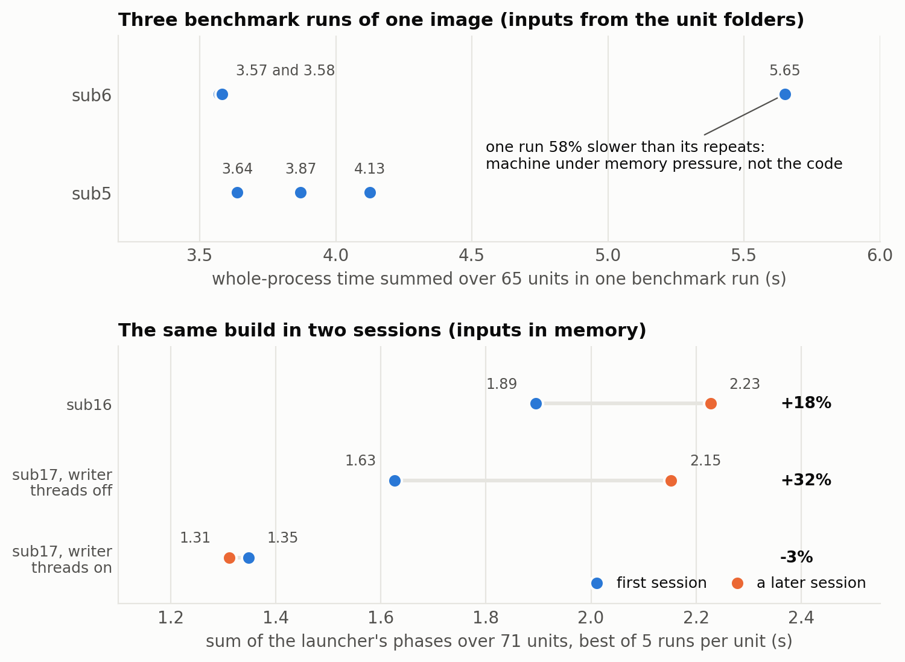

*Figure 4. Top: why single benchmark runs were not trusted. One of three runs of the same image was 58% slower; on its own it suggested that sub6 was slower than sub5, and two repeats showed the opposite. Bottom: the later method (inputs in memory, all 71 units, best of 5 runs per unit) does not remove the problem between sessions. The same build measured in two sessions gave 1.89 s and 2.23 s for sub16 (+18%), 1.63 s and 2.15 s for sub17 with writer threads off (+32%), and 1.35 s and 1.31 s for sub17 with writer threads on (−3%). The two panels are different measurements and their seconds are not comparable.*

### 4.3 Decision support

A typed decision-routing model was used at seven points to rank candidate next steps from a written state description. Its answers were recorded together with what we then did; it was not always followed and not always right (§6.8, §8). Parallel research and review agents were used seven times: to check the rules (which revealed the scoring change), for a four-way study of the competition, container start-up costs, the literature and our own code (§6.5), for two read-only reviews (§6.7), and for three studies: a score model, a search for public code by other teams, and a review of the engine (§6.8).

---

## 5. Results

### 5.1 History under the old rule

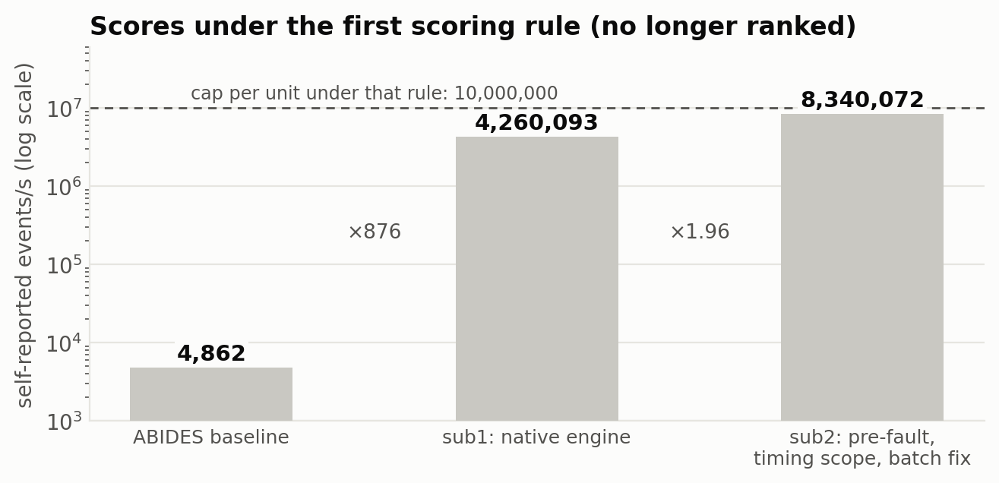

*Figure 5. Scores while the board ranked self-reported simulation-loop rates, on a logarithmic axis; the figures between the bars are the ratios of one step to the next, and the dashed line is that rule's cap of 10,000,000 per unit. These runs are no longer ranked.*

The step from sub1 to sub2 came from three findings: about a third of loop time was kernel page-fault handling for output buffers (fixed by pre-faulting); our timer covered work the reference's timer did not; and batch units were timing process-pool start-up.

### 5.2 Engine rewrite (sub4)

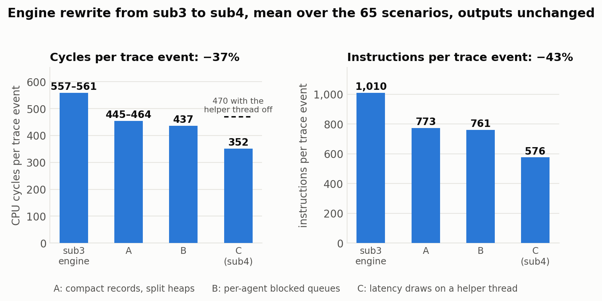

*Figure 6. The engine rewrite from sub3 to sub4, mean over the 65 scenarios. Left: CPU cycles per trace event, 557–561 to 352 (−37%). Right: instructions per event, 1,010 to 576 (−43%). Step C moves the latency draws to a helper thread: with that thread switched off the same binary measured 470 cycles per event (dashed mark); its instruction count in that mode was not recorded. This figure covers only that rewrite; the engine changes of sub17 and sub18 are in Figure 17, measured differently (totals on one unit, not means per event).*

| Step | Change | Key observation behind it |
|---|---|---|
| A | 56-byte messages, 40-byte ledger records, raw-cursor buffers, two 4-ary heaps, replace-top trick, inline rounding | Flat profile dominated by per-field bookkeeping |
| B | Per-agent blocked queues | In some scenarios 73% of loop iterations only re-queued a message for a busy agent |
| C | Latency draws produced by a helper thread with a wait-free hand-over | Random numbers and latency were about 45% of loop instructions |

### 5.3 Where the time went once containers were timed

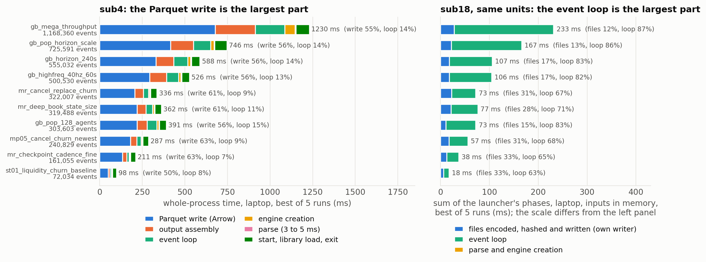

*Figure 7. Left: whole-process time inside the sub4 image for ten large units (the eight largest and two smaller ones), best of 5 runs. The Parquet write through Arrow is the largest part of every bar, 50–63%; the event loop is 7–15%. Right: the same units in sub18, for contrast. This is a different measurement (sum of the launcher's phases, inputs in memory, helper thread on, writer threads off, one session; §5.11) on a different scale, so the two panels compare shares, not milliseconds. In sub18 the event loop is 63–87% of each bar and the files 12–33%. No such per-phase measurement was recorded for sub19a.*

The left panel is the central observation of the study. We had spent the preceding days on its event-loop segment.

### 5.4 Replacing the writer (sub5) and shrinking the files (sub6)

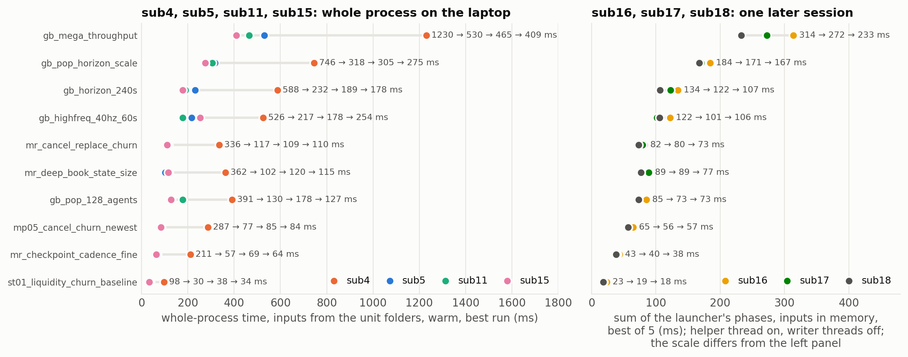

*Figure 8. Whole-process time on the laptop for ten large units: sub4 (orange), sub5 (blue), sub11 (green), sub15 (pink). Warm runs, best per unit. sub4 and sub5 were measured with the ledger always written; sub11 and sub15 from the unit directories, in the memory mode they ship in. Differences between the last three are within that machine's run-to-run spread. All four series include the time of the laptop's input mount (§5.11). Right: the same units for sub16 (yellow), sub17 with writer threads off (green) and sub18 (grey), all three measured in one later session with the inputs in memory, as the sum of the launcher's phases (session C of §5.11). The right panel is a different measurement on a different scale and must not be read as a continuation of the left one. Within it, sub18 is at or below sub16 on all ten units; sub17 against sub16 was 3% in this session and 14% in another, so the size of each step is not established. sub19a has no such measurement.*

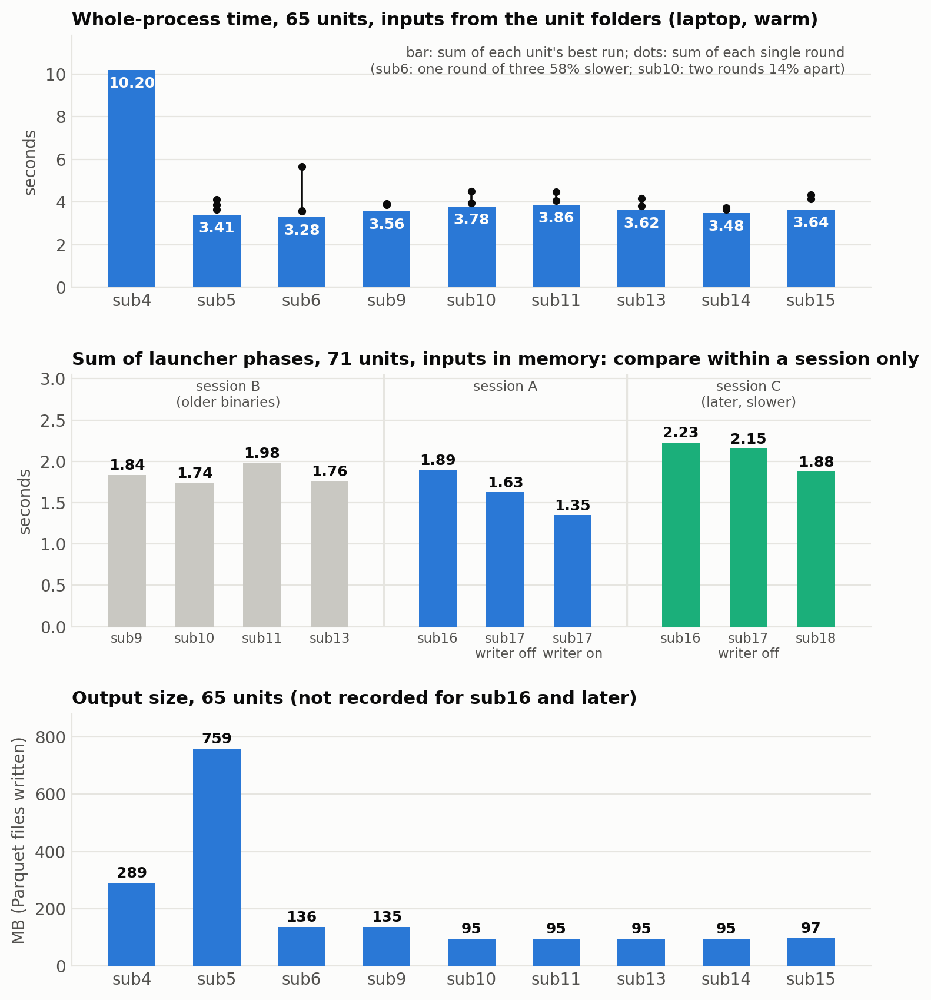

*Figure 9. Top: whole-process time on the laptop summed over the 65 single units, inputs read from the unit folders (warm). Each bar is the sum of every unit's best run; the dots are the sums of the single rounds behind it (three for sub5 and sub6, two for sub9 to sub15, one for sub4). After the step from sub4 to sub5 the total hardly moves: the later builds differ by less than the spread between rounds of one build (up to 14%, and 58% for one round of sub6), and from sub11 on they run without huge pages, which costs time on the laptop and none on the scoring host (§5.9). These times include the laptop's input mount, 10–20 ms per run (§5.11). Middle: the later measurement, with the inputs in memory, summed over all 71 units as the launcher's phases, grouped by session (§5.11). It is a separate series: its seconds are not comparable with the top panel, and only bars within one session are comparable with each other; sub16 appears twice, at 1.89 s and 2.23 s. sub19a was not measured this way. Bottom: total output size. sub5's uncompressed files are 2.6× larger than Arrow's; with delta encoding (sub6) they are 2.1× smaller than Arrow's; from sub10 the ledger is not written on six units. Output size was not recorded for sub16 and later; sub19a was checked to write the same bytes as sub16 on the 65 units. Output sizes are not affected by the input mount.*

sub5 also made the launcher a static binary (1.4 MB; sub4 mapped 61 MB of shared libraries at start) and ran the trace and ledger output chains on separate threads.

### 5.5 Scores under the new rule

| Submission | What changed | Score | Change | Against |
|---|---|---:|---:|---|
| sub4 | Rewritten engine; launcher without Python; Arrow writer; 773 MB image | 153,825.02 (and 151,386.96 on a second upload) | — | |
| sub5 | Own Parquet writer and SHA-256; static launcher; parallel output chains | 181,495.89 | +18.0% | sub4 |
| sub7 (scratch) | Delta-encoded integers; ledger encoded straight from engine records; launcher accepts whole numbers written as floats; **2.2 MB single-layer image without Python** | 184,857.72 | +1.9% | sub5 |
| sub9 (scratch) | Memory work of §5.7: fewer page faults, fewer passes over memory | 183,419.75 | −0.8% | sub7 |
| sub10 (scratch) | No message ledger on the six units whose card does not require one | 188,687.15 | +2.9% | sub9 |
| sub11 (scratch) | Profile-guided build; earlier exit; huge-page requests and up-front buffer population switched off | 189,018.28 | +0.2% | sub10 |
| sub13 (scratch) | Streamed output in 65,536-row groups; pooled threads; less allocation churn; at most four busy threads | 184,046.62 | −2.6% | sub11 |
| **sub16 (scratch)** | Trace built in its final order during the run (no merge, sort or index pass afterwards), with exact repair for out-of-order rows; agent fields regrouped; allocator settings; sub11's writer | **203,394.47** | +7.6% | sub11 |
| sub17, writer threads off | sub16 + branch-free heap step + helper thread started at engine creation | 196,164.84 | −3.6% | sub16 |
| sub17, writer threads on | The same with both files written during the run | 199,285.22 | +1.6% | sub17, writer threads off |
| sub16, helper off | The sub16 binary with the latency helper thread switched off by an environment variable | 185,818.35 | −8.6% | sub16 |
| sub18, helper off | sub17 + compact trace rows, less bookkeeping, wakeup rings, sorted blocked queues (§5.8); helper thread off | 193,962.28 | +4.4% | sub16, helper off |
| sub19a | sub18's engine with sub16's helper-thread code restored | 199,057.73 | +2.6% | sub18, helper off |

The sequence of best scores is 153,825 → 181,496 → 184,858 → 188,687 → 189,018 → 203,394. It is not the sequence of uploads: sub9, sub13 and both variants of sub17 scored below the best at the time, the upload of sub16 with the helper off was a bet that lost (§5.10), that of sub18 with the helper off was made to measure, not to improve, and sub19a, which combined the two things the host had favoured separately, scored 2.1% below sub16. The last six rows are analysed in §5.10.

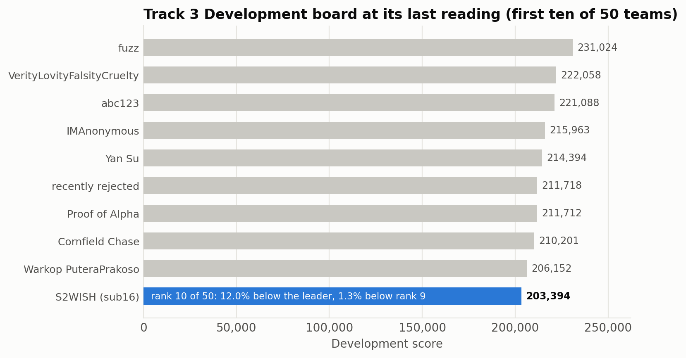

*Figure 10. The first ten of 50 teams on the Development board, from a screenshot. The board keeps each team's best score; ours is that of sub16, 12.0% below the leader and 1.3% below the team in ninth place. sub19a, uploaded last, scored lower and did not change it.*

### 5.6 A model of the score

Let unit *i* have *Nᵢ* events and local best process time *tᵢ*. We model the score as

  score = mean over units of *Nᵢ* / (*c* + *k*·*tᵢ*),

with *c* the fixed container cost on the scoring host and *k* the ratio of their process speed to ours. The scores of sub4 and sub5 give two equations: **c = 0.551 s, k = 0.50**.

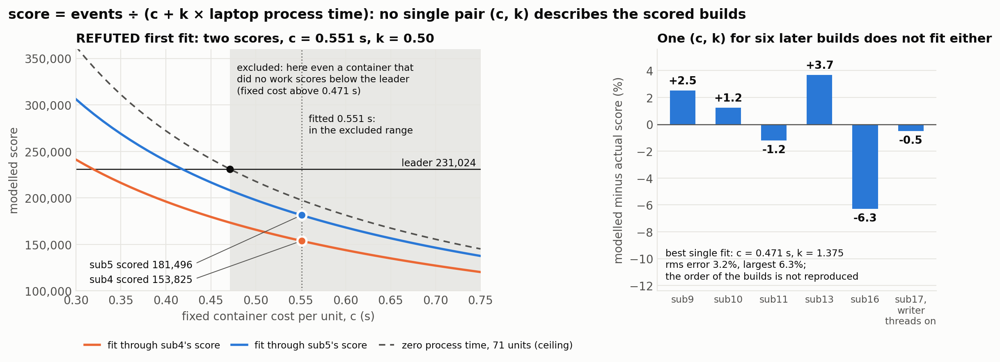

*Figure 11. The score model and why it does not hold. Left: the first fit, refuted. The two curves are the model through our scores of sub4 and sub5 (computed on the 65 single units, k = 0.50); the dashed curve is the score of a container that does no work, over all 71 units. In the shaded range that ceiling is below the leader's score, so a fixed cost above 0.471 s is excluded, and the fitted 0.551 s lies inside it. Right: the best single pair (c = 0.471 s, k = 1.375) for six later builds, with laptop process time measured with the inputs in memory: modelled minus actual score per build. The errors reach 6.3% (rms 3.2%) and the order of the builds is not reproduced.*

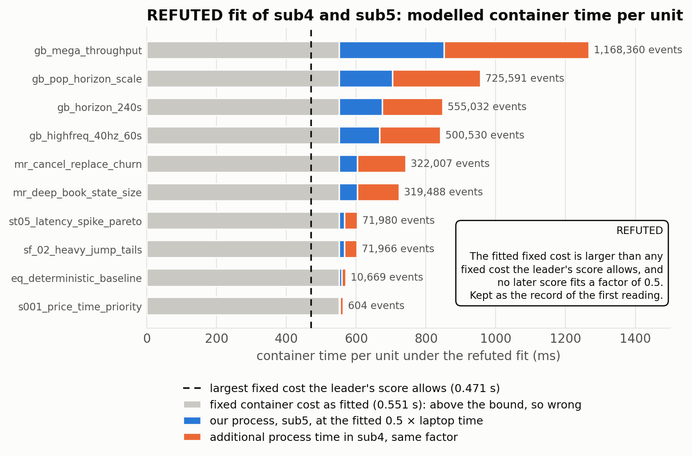

*Figure 12. Container time under the refuted first fit, for ten units spanning the size range; kept as the record of what we believed. The dashed line is the largest fixed cost the leader's score allows (0.471 s); the fitted 0.551 s exceeds it, and the process parts are drawn with the fitted factor of 0.5 on laptop time, which no later score supports. What survives is qualitative: on small units the measured time is mostly a cost the participant does not control.*

The fitted *c* agrees with independent published measurements of warm `docker run` (about 0.55–0.57 s for images from 5 MB to 155 MB). But the model's ceiling at *c* = 0.551 s is about 209,000, **below the leader's 231,024**. The model is therefore missing something. Candidates we could not test: the six batch units, which the model omits; a fixed cost that differs between units or submissions; run-to-run variation; and an error in transferring per-unit time ratios from our laptop.

**Correction.** The fit is wrong, not merely incomplete. The public roster has 7,728,572 events over 71 units, a mean of 108,853 per unit. A submission that did no work at all would score 108,853 ÷ *c*, so the leader's 231,024 requires **c ≤ 0.471 s**. With a lower *c* the same scores imply a larger *k*: our process is probably 1.5 to 2.4 times slower on the scoring host than in our warm laptop runs, not twice as fast. The two parameters cannot be separated from the scores we have; figures 11 and 12 show the superseded fit and are kept as the record of what we believed. (That range rests on laptop process times that include the input mount of §5.11, so it is itself only indicative.)

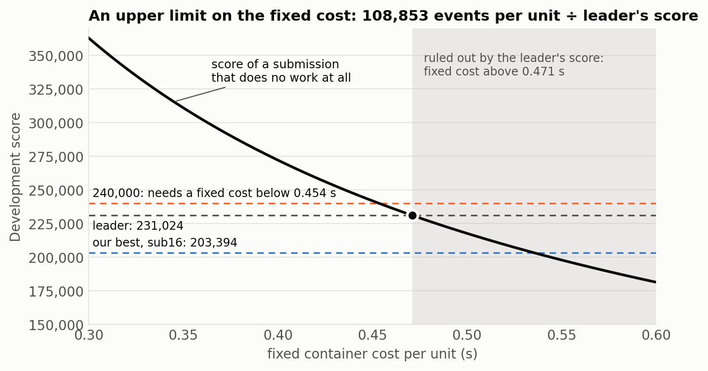

*Figure 13. The score a submission would get with no process time at all, as a function of the fixed container cost. The leader's score rules out everything to the right of 0.471 s. Reaching 240,000 with no work at all would need a fixed cost below 0.454 s; with real work it needs correspondingly less.*

**No replacement.** A review agent was asked to build the best score model it could from our scores and the corrected laptop process times. Its result is negative. A model of the form "fixed cost + *k* × laptop process time" cannot reproduce even the ranking of our own builds (rms residual 3.2%, largest 6.3%, against steps between builds of 0.2–7.6%). The smallest structure that fits needs five parameters for six points (a factor for the memory mode, a factor for the new engine, and a penalty of 27–41 ms per unit for builds that write incrementally), which is a description, not a model; a per-write cost came out inconsistent by a factor of 9–16. It predicted sub17 without writer threads at 205–209K if that penalty were real and 189–194K if sub17's own changes cost time; the score, 196,165, fell between, and the penalty reading was then contradicted when the same build scored higher with writer threads on. We gave three score projections for sub17 from laptop timing (197–205K; then 205–209K and 209–219K for the two variants); the scores were 196,165 and 199,285. The fixed cost on the host remains unknown, bounded above by 0.471 s; a participant from another team has reported "a fixed per-container cost of roughly half a second" (organizers' issue #34), which we cannot check. The same agent's arithmetic from sub16's score, for what it is worth as a bound and not a plan: 220,000 would need our process time on the host cut by 27% (if the fixed cost is 0.36 s) to 46% (0.44 s), and 230,000 by 41% to 68%.

### 5.7 Memory, not computation (sub8, sub9)

A code review found that on the largest unit the process touched roughly 430 MB of fresh memory to hold 98 MB of records and write 22 MB of output. Instrumenting the launcher with resource counters confirmed the pattern: summed over the units, kernel time (4.5 s) was almost equal to user time (5.0 s).

| Change | Version |
|---|---|
| Encoder scratch buffers no longer zero-filled to their worst-case size | sub8 |
| Pre-fault only the part of each engine buffer that is likely to be used (public units use at most 58–68% of the reservation) | sub8 |
| Large column arrays aligned and advised for huge pages | sub8 |
| Trace built as a 4-byte-per-row merged index; its columns encoded straight from engine records instead of from seven materialised arrays | sub9 |

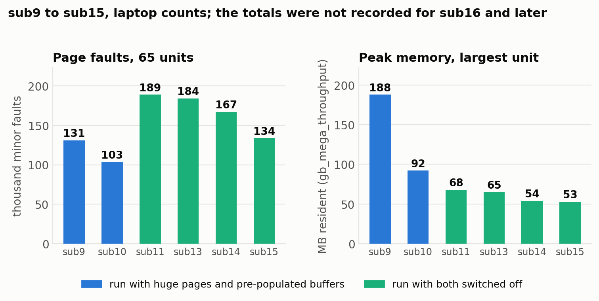

*Figure 14. Left: page faults summed over the 65 units. Right: peak resident memory on the largest unit. sub9 and sub10 were run with huge pages and pre-populated buffers, as shipped; sub11 to sub15 with both switched off (sub14 and sub15 were never uploaded), which is why faults rise at sub11 while peak memory keeps falling. The earlier steps sub7 → sub8 → sub9 took faults from 367 to 191 to 125 thousand over 59 units. The figure stops at sub15 because these totals were not recorded for later builds; the only later count is on the largest unit alone, where the 32-byte trace row of sub18 took page faults from 14,654 to 12,354 on a test build (§5.11).*

sub8 used 13% less process time than sub7 in four interleaved runs (3.75 s against 4.3–4.4 s over 65 units; both runs of each image agreed). sub9's timing is reported in §5.8. **On the scoring host this work gained nothing:** sub9 scored 183,420 against 184,858 for the build without it (§5.9). The section title describes the laptop.

### 5.8 Later builds

Every build below passed the same validation before it was pushed or used as a base: tables equal on 65 scenarios, byte-identical files across three repeated runs, 6 batch units under the runtime restrictions, the organizers' regression suite 65 of 65, and the fuzz replay 1,318 of 1,318. Exceptions are stated.

| Build | What it adds to the one before | Local measurement | Score |
|---|---|---|---:|
| sub8 | No zero-filled scratch, partial pre-fault, huge pages, unicode-escape decoding | −13% process time over 65 units | not uploaded |
| sub9 | Index-based trace output; hashing thread only for files above 4 MB | −12% process time over 65 units | 183,420 |
| sub10 | No message ledger on six units (§5.9) | −11.9% on those six units | 188,687 |
| sub11 | Profile-guided `-O3` build; exit before buffers are freed; memory switches (shipped off) | −1.9% from the build; switches off cost about +70% on the largest unit | 189,018 |
| sub12 | Files streamed in 65,536-row groups through reused buffers | peak memory 92 → 88 MB on the largest unit | not uploaded |
| sub13 | Pooled encoder threads, per-thread scratch, allocator settings, at most four busy threads, agent fields regrouped | 3.62 s over 65 units against sub11's 3.86 s (inside the spread) | 184,047 |
| sub14 | Trace built in its final order during the run; no merge or sort afterwards | −6.8% over seven units interleaved; peak memory on the largest unit 65 → 54 MB | not uploaded. Validation passed, but 29 fuzz cases with a negative latency fell to the reference path (see below) |
| sub15 | One writer thread per file encodes, hashes and writes finished rows during the run, in 4,096-row groups; exact handling of out-of-order events restored | Fast checks pass (tables 65/65, no-ledger units 6/6, byte-stable and equal to the output without writer threads, 29 of 29 negative-latency cases equal to sub13). Timing against sub14 inconclusive: −14% in one interleaved run, +12% in another on a loaded machine | not uploaded; its full validation was started and stopped, and never completed |
| sub16 | sub15's engine with sub11's writer as the default: files built after the run, columns encoded on two to four threads; the writer threads of sub15 remain as a switch | 4–7% less process time than sub11. The fuzz replay stopped at 200 of 1,318 in the first validation when Docker failed ("unexpected EOF"); repeated on the same image before the upload, it gave 1,318 of 1,318 (22 handed to the Python path) | **203,394**; with the helper thread off 185,818 |
| sub17 | (1) Heap step that chooses among four children by index arithmetic instead of branches; (2) helper thread starts producing at engine creation, with no mutex or condition variable, and the event loop returns to it whenever it is ahead instead of abandoning it for the run once it is late; (3) writer threads selectable at image build | Counters in §5.11. Full validation passed (run with writer threads on); fuzz replay 1,318 of 1,318, of which 1,293 in the launcher | 196,165 (writer threads off); 199,285 (on) |
| sub18 | (1) 32-byte trace row, with a guard that stops the run if a value does not fit; (2) own-order bookkeeping only for market makers, its only reader; (3) fast path for a trace bucket of one order row and no quote; (4) no delivery record when the ledger is skipped; (5) wakeups in up to four per-interval rings, the heap as catch-all; (6) blocked queues as sorted vectors with a read position; (7) the helper sleeps while its ring is full and is woken when half of it is used; ring enlarged from 2¹³ to 2¹⁵ values | Counters in §5.11. Full validation passed; fuzz replay 1,318 of 1,318, of which 1,291 in the launcher | 193,962 with the helper thread off. **Not scored with the helper on** |
| sub19a | sub18's engine with sub16's helper code restored verbatim (woken at the start of the run, spinning when its ring is full, ring of 2¹³, permanent fallback to drawing in the loop once late) | Byte-identical to sub16's output on 65 of 65 units; tables, repeat-run bytes, batch, fallback and official regression passed; fuzz replay 1,318 of 1,318 (22 handed to the Python path); scratch image checks passed; pushed as `native-v19a` | 199,058 |

A variant, sub19b, differs from sub19a only in restoring the branching heap step; it produces the same bytes on the 65 units and passed the full validation in its full image (fuzz replay 1,318 of 1,318); no scratch image of it was built and it was never uploaded. An image of sub18 with the sleeping helper switched on was pushed and never uploaded.

**A gap that the validation exposed.** sub14 passed every validation step, but the fuzz replay's breakdown changed: 29 cases that earlier builds handled in the launcher were now handed down to the reference path. All 29 use a negative network latency, which lets an event be delivered before the current time, so trace rows no longer arrive in time order. Earlier builds had a full-sort path for that; building the trace during the run had dropped it and failed the run instead. The outputs were still correct, because the full image falls back, but a scratch image has no fallback and would have failed those units. sub15 rebuilds the trace by the full rule when it happens and restarts the file its writer thread had begun. A pass or fail verdict would not have shown this; the count of who handled each case did.

**The count moves again.** The same count shows a second, smaller effect that is not resolved. In a launcher-only pass the launcher declines 23 of the 1,318 cases, identically for sub16, sub17 and sub18 (19 for a flag that is not a boolean, 4 for the `log` guard of §7.3). In the full replays it handed down 25 cases in sub17 and 27 in sub18. Our explanation, not confirmed by a targeted test: the helper thread draws latencies ahead of the event loop, a draw the run never consumes can still raise the global "sensitive to `log`" flag, and the larger ring of sub18 looks further ahead. In a full image such a case falls back and passes. In a scratch image it would exit with status 127 and the unit would score zero. No public unit is affected: all 71 are handled by the launcher in every run made. A fix exists in the source only (the flag is raised after the run, and only for a draw the run consumed); it gives identical bytes on 65 of 65 units with the helper on and off, and is in no image and has not been fuzz-replayed.

### 5.9 What the scoring host rewards

By the time sub13 was scored we had six steps with both a laptop measurement and a host score.

| Step | Kind of change | Laptop, warm | Host |
|---|---|---:|---:|
| sub4 → sub5 | Interpreter and Arrow encoder removed | −67% process time | +18.0% |
| sub5 → sub7 | Smaller files, direct ledger encoding, 2.2 MB image | a few percent | +1.9% |
| sub7 → sub9 | Fewer page faults, fewer passes over memory | −23% | −0.8% |
| sub9 → sub10 | Ledger not recorded or written on six heavy units | −11.9% on those units | +2.9% |
| sub10 → sub11 | Profile-guided build, earlier exit, memory switches off | −1.9%, then about +70% on the largest unit | +0.2% |
| sub11 → sub13 | Streamed writer, pooled threads, thread cap, allocator settings | −6% over 65 units, inside the spread | −2.6% |

The host pays for removed instructions and removed output. It does not pay for avoided page faults, and it does not charge when they are restored.

The last row is the least understood. sub13 changed five things at once and was uploaded without a timing comparison, because the machine was busy and warm timing had just been discredited. Our first explanation was that its writer encodes any file below 65,536 rows on one thread where sub11 used several; the laptop measurement taken afterwards does not support that (sub13 is, if anything, faster there on small units). The drop is 1.6 times the difference once seen between two identical uploads, so we thought it might be partly noise, a reading that the later statements about the host weaken (§4.2). We do not know which of the five changes, if any, cost the 2.6%. sub16 therefore returned to sub11's writer and changed, in the main, one thing: the trace assembly. It scored 203,394 (§5.10). That score, and the later gain from writer threads during the run, argue against the reading we favoured at the time, that a streaming writer as such loses on the host; they do not explain sub13.

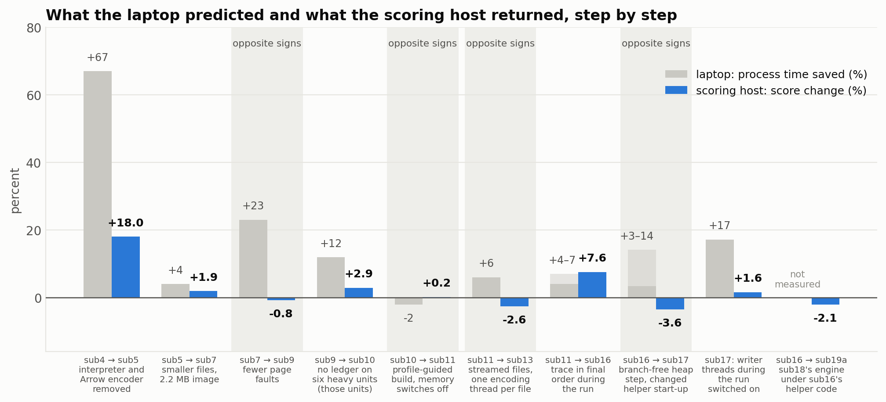

*Figure 15. For each step between scored builds: the change in process time measured on the laptop (grey, positive = time saved) and the change in score on the scoring host (blue). The first six steps are those of the table above; the laptop over-promised on memory work, under-promised on removed output, and had the wrong sign for sub13. The last four are from the final uploads (§5.10). For sub11 → sub16 the laptop comparisons gave a range of 4–7%; the bar is solid up to the low end and lighter up to the high end. For the two sub17 steps the laptop figure is process time over all 71 units with the inputs in memory; sub16 → sub17 was timed in two sessions, which gave 14% and 3%, and is drawn as a range in the same way. The laptop saw a gain in both sessions where the host returned −3.6%. For sub16 → sub19a (−2.1% on the host) no laptop figure of that kind was taken. The laptop bar for sub5 → sub7 is the one measured for the intermediate build sub6. In four of the nine steps that have both figures, shaded, the two instruments disagree in sign.*

**The ledger rule.** Each unit's card states whether a message ledger is required (`[scoring.params].requires_message_ledger`). Twelve of the 71 public cards say it is not: six single-scenario units and the six batch units. The organizers' README tells submissions not to write the file on such units; the scorer returns a pass for the ledger gate without opening it, and the two ledger fields of `events.json` are not among its required keys. Batch units need a ledger for every sub-scenario regardless. The organizers confirmed that the runner mounts a unit's input folder as a whole, so the card is present beside the scenario; that writing the ledger everywhere is always safe; that batch units need a ledger for every sub-scenario whatever the card says; and that the scenario family must not be used as a stand-in for the flag. The six usable units hold 3.32 million of the 7.73 million public events. The launcher reads the card that is mounted beside the scenario and skips the ledger only for that exact declaration; anything else means the ledger is written. We had read that README section for the file format and missed what it permits for nine days.

**Warm and cold.** All our timing had repeated `simulate` inside one running container and taken the best of N. The host starts one fresh container per unit and runs once. Timed that way on the laptop, the largest unit's process took 500 to 1,200 ms against 232 ms warm, and its buffer set-up phase ranged from 33 to 429 ms between runs. The laptop's Docker VM has 2.76 GiB of memory and its input mount is Windows-backed (two days later we measured what that mount costs, §5.11), so much of that is the laptop. CPU-quota throttling was not involved (zero throttled periods in six of six runs). The conclusion we draw is narrow: **local timings of anything related to memory or threads are not evidence about the scoring host, in either direction**, and an upload is the only instrument. Uploads are capped at 5 per day and, as we believed that day from a toolkit document, 20 in total; the competition page allows 23 per person (§8).

### 5.10 Six uploads that each answer one question

sub16 was uploaded and scored 203,394.47, 7.6% above sub11. The laptop comparisons had suggested 4–7% less process time, so for once the host paid more than the laptop promised. Five more uploads followed. Results arrived much faster than the 45–60 minutes of the earlier uploads.

| Upload | Build and setting | Score |
|---|---|---:|
| 975649 | sub16, scratch image, memory switches off | 203,394.47 |
| 976478 | sub17, writer threads off | 196,164.84 |
| 976489 | sub17, writer threads on (`T3_TRAIL=1`) | 199,285.22 |
| 976768 | sub16 binary, latency helper thread off (`T3_LAT_THREAD=0`) | 185,818.35 |
| 976794 | sub18 binary, helper thread off | 193,962.28 |
| 977400 | sub19a: sub18's engine with sub16's helper code | 199,057.73 |

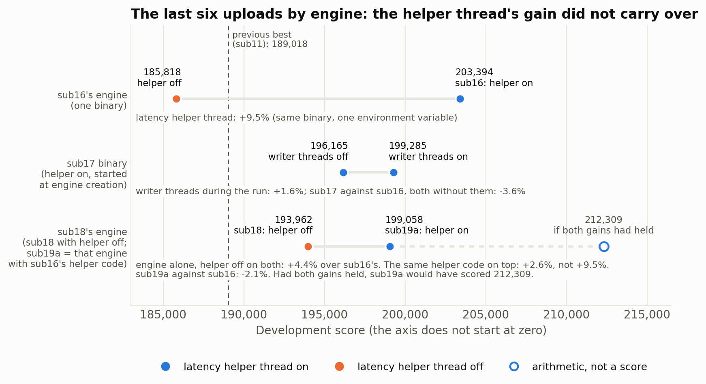

*Figure 16. The scores of the last six uploads (the six of the table above), grouped by engine. Blue: latency helper thread on; orange: off. On sub16's engine the helper thread is worth +9.5% (185,818 → 203,394); on sub18's engine the same helper code is worth +2.6% (193,962 → 199,058). sub18's engine is 4.4% better than sub16's with the helper off on both, yet sub19a scored 2.1% below sub16: the two gains did not add up. The hollow marker is what sub19a would have scored had both held (193,962 × 203,394 ÷ 185,818 = 212,309); it is arithmetic, not a score. The horizontal axis does not start at zero. Each filled point is one upload.*

| Comparison | Host result | What it establishes |
|---|---:|---|
| sub11 → sub16 | +7.6% | Building the trace in order during the run, with the three passes after the run and their threads removed, paid more than the laptop suggested |
| sub16, helper off → sub16 | +9.5% (−8.6% read the other way) | Same binary, one environment variable. The helper thread helps on the host. This is the cleanest single-variable measurement of the project |
| sub16, helper off → sub18, helper off | +4.4% | sub18's engine, which contains sub17's branch-free heap step, is better on the host at an equal helper setting |
| sub16 → sub17, writer threads off | −3.6% | sub17's engine is better (previous row), yet sub17 scored lower. By elimination we first put this down to sub17's changed helper start-up; the last two rows weaken that reading. **The mechanism is not established** |
| sub17, writer threads off → on | +1.6% | Writer threads during the run were a small gain on this binary |
| sub18, helper off → sub19a | +2.6% | sub16's helper code under sub18's engine. The same code that is worth 9.5% on sub16's engine is worth 2.6% here |
| sub16 → sub19a | −2.1% | The engine gain (+4.4% without a helper) and the helper gain (+9.5% on sub16) did not add up. sub19a landed within 0.1% of sub17 with writer threads on, although it carries sub16's helper start-up |

**The bundle.** sub17 shipped two things together. One was measured: the branch-free heap step cut branch misses on the largest unit from 11.59 to about 5 million and cycles by 8–17% (§5.11). The other was speculative: the helper thread's start-up was changed "as a safeguard", with no evidence from the host that the old start-up was a problem. The build scored 3.6% below its predecessor. It took the two helper-off uploads to show that the engine was not at fault, and the question of what exactly went wrong with the helper is still open. A guess, untested: a thread that runs from the moment the engine is created is placed by the scheduler's balancing at thread creation, possibly far from the simulation thread and even on another socket, whereas a thread woken by the simulation thread at the start of the run is placed near it. The leading team's member has written, in the organizers' issue tracker, that whether the simulation thread shares a physical core with a helper thread moves a large unit's median window by about 6%; that is their statement about their program, not a measurement of ours. sub19a (§5.8) restored sub16's helper code under sub18's engine to test the elimination argument directly. It scored 199,057.73: above sub17 without writer threads, but 2.1% below sub16. So restoring the old start-up did not restore the old score, and the start-up change cannot be the whole explanation. A second guess, equally untested: once the event loop is fast enough it catches up with the helper, and in sub16's helper code a loop that finds the helper behind at the start draws its own latencies for the rest of that run, so a faster engine forfeits most of the helper's benefit.

**What we announced that day and had to withdraw.** We keep these in the record because they are the finding.

- "Writer threads lose on the host." Said when 199,285 (writer threads on) arrived before the score of its comparison build and was read against sub16's 203,394. The comparison build then scored lower still, 196,165: writer threads had gained 1.6%.
- "Adding or strengthening a thread loses; removing threads wins." A pattern read from nine score steps, with one counterexample dismissed. On its strength we held it more likely than not (60 to 40) that sub16 with the helper off would beat 203,394, and spent an upload on it. It scored 185,818.
- Three score projections for sub17 from laptop process times (§5.6), none of which held.
- A piece of arithmetic (185,818 × 1.056 = 196,222, close to sub17's 196,165) suggested that sub17's helper was not working at all on the host. The sub18 upload neither proved nor disproved that; it showed only that the engine is better.

After the sixth upload the team had used 22 of its 23 uploads; one remained.

### 5.11 Counting instead of timing

**The input mount.** A system-call trace of the smallest unit (`t3-s001-price-time-priority`, 604 events) showed 9.65 ms in the first `openat` of `card.toml`, 2.08 ms in the `openat` of `scenario.json`, and 0.2–1.0 ms for each `read`, `fstat` and `close` on those files. Everything after the inputs had been read took under 4 ms. The unit folders are a Windows-backed mount, and each run paid 10–20 ms for it that the scoring host does not charge.

*What this affects.* This was established for measurements taken from the unit folders: the sub11 and sub15 series of Figure 8, the sub9–sub15 bars of Figure 9, the 3.62 s and 3.86 s totals in §5.8, and the laptop bars for sub10 → sub11 and sub11 → sub13 in Figure 15. The lab record treats every whole-process laptop figure from sub4 on as affected, which adds Figure 7, the sub4–sub6 values of Figures 8 and 9, and the process-time entries of the tables in §5.8, §5.9 and §7.1; the earliest of those measurements were not themselves traced. A constant per run cancels in a difference between two builds but dilutes every ratio, and over 65 runs it amounts to 0.65–1.3 s inside totals of 3.4–3.9 s (our arithmetic from the per-run figure, assuming it is the same for every unit). Counts (page faults, peak memory, output size, instructions) are not affected, nor is any host score.

**Process time with the inputs in memory.** All 71 units (65 single and 6 batch), best of 5, in seconds. For single units this is the sum of the launcher's phases, so it is not directly comparable with the whole-process totals above.

| Session | Builds |
|---|---|
| A | sub16 1.895; sub17, writer threads off 1.627; sub17, writer threads on 1.348 |
| B (older binaries) | sub9 1.838; sub10 1.736; sub11 1.982; sub13 1.759 |
| C (later, slower) | sub16 2.228; sub17, writer threads off 2.152; sub18 1.876 |

Only ratios within one session mean anything, and not always those: sub17 is 14% faster than sub16 in session A and 3% faster in session C. A further run of eight binary and helper combinations was thrown away: the laptop was two to three times slower than in the earlier session, and two rounds of one binary differed by up to 45%.

**Hardware counters.** One thread (helper and writer threads off), profile-guided builds, user-mode counts in millions.

| Unit | Build | Cycles | Instructions | Branch misses |
|---|---|---:|---:|---:|
| `t3-gb-mega-throughput` (largest: 144 agents, 1,420,862 kernel events, 1,168,360 trace rows, no ledger) | sub16 | 934–945 | 1,395 | 11.59 |
| | sub17 | 787–863 | 1,324 | 4.93–5.12 |
| `t3-mr-deep-book-state-size` (269,644 kernel events, 115,505 of them re-queued as blocked) | sub16 | 279–289 | 420.6 | 2.53 |
| | sub17 | 255–275 | 407.8 | 1.64–1.67 |
| `t3-as06-throughput-fast` | sub16 | 72.0 | not recorded here | 0.643 |
| | sub17 | 66.6 | not recorded here | 0.412 |

With the helper off, the heap step is the engine change that separates these two builds. It removes 5% of instructions and more than half of the branch misses on the largest unit.

The changes of sub18 were measured one after another on test builds without profile feedback (same unit, one thread, millions):

| Build | Instructions | Cycles | Branch misses | Other |
|---|---:|---:|---:|---|
| sub17 engine | 1,491.7 | 830–850 | — | |
| + 32-byte trace rows | 1,470.2 | 797–805 | 5.12 | page faults 14,654 → 12,354 (a count, not millions); cache misses 2.6–2.8 → 2.05–2.14 |
| + own orders only for market makers, one-row buckets, no record for a skipped ledger | 1,429.0 | 750 | 4.71 | |
| + wakeup rings and sorted blocked queues | 1,381.5 | 733 | 4.35 | on `t3-mr-deep-book-state-size` this step took cycles from 264.6 to 237.8 and branch misses from 1.77 to 1.58 |

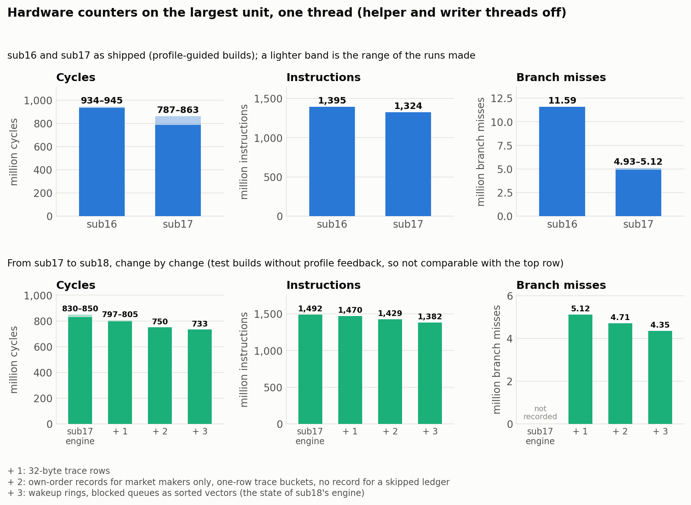

*Figure 17. Hardware counters on the largest unit, one thread. Top: sub16 and sub17 as shipped (profile-guided); where several runs gave a range, the lighter band shows it. Bottom: cycles, instructions and branch misses after each group of changes that went into sub18, on test builds without profile feedback, which is why the first instruction bar is higher than sub17's in the top row; the two rows are not comparable. The branch-miss count of the first test build was not recorded. No counter run of sub18 as shipped or of sub19a was recorded, so neither appears; sub19a's engine is that of the last bar with the helper-thread code of sub16, which this one-thread measurement does not exercise.*

In total sub18's changes remove 7.4% of the instructions of the sub17 test build on this unit. On the host, with the helper off, sub18 scored 4.4% above sub16; that step contains the heap change as well, and no upload separates the two.

**Where one thread's cycles go** (largest unit, sub17 test build): the event loop with its inlined handlers 21.7%; latency draws about 27.5% (the normal deviate 11.5%, `exp` 7.4%, `log` 4.3%, the latency function 4.4%); output encoding and SHA-256 about 20%; the heap step 5.8%; sending 4.1%; setting wakeups 3.7%; limit-order handling 3.6%; closing trace buckets 2.6%. The latency share is the work the helper thread takes off the simulation thread.

**The helper and the writer threads on the laptop.** With the helper the simulation phase of the largest unit took 211–220 ms, without it 257–298 ms (52–55 against 61–63 ms on the deep-book unit; 122–138 against 151–170 ms on `pop-horizon-scale`). Here the laptop and the host agree in sign. A helper that sleeps while its ring is full was slower than a spinning one at the old ring size (minimum and median of 13–15 interleaved runs on `horizon-240s`: 115.6 and 125.8 ms against 104.3 and 118.4) and faster with a ring of 2¹⁵ values (99.1 and 105.8), which is what sub18 uses; with that ring it was also slightly faster on the largest unit (221.0 and 246.2 against 226.8 and 262.6) and about equal on the deep-book unit (61.0 and 66.2 against 60.4 and 65.7). This sleeping helper has no host score. Writer threads during the run cut the laptop's process time on every unit tried (largest unit 198.3 → 175.7 ms; deep-book 63.9 → 51.9; `cancel-replace-churn` 62.0 → 46.4, best of 9, same binary), 17% over all units in session A, where the host returned 1.6%.

**Tried and dropped.** A heap padded with sentinels, so that every node has four readable children, removed a further 2.0% of instructions on the largest unit (1,324.3 → 1,296.0 million) but left cycles within noise and slightly worse on one unit. It was reverted before sub17 was built: fewer instructions is not the goal.

---

## 6. Investigations

### 6.1 Why did the first native submission score half of what the engine could do?

A `perf` profile of the loop showed about a third of the time in the kernel's page-fault handler for output buffers that are written once. Pre-faulting them, timing the same scope as the reference adapter and fixing the batch timer took the score from 4.26M to 8.34M.

### 6.2 Why did a few units stay far below the others?

Per-scenario loop counters showed "requeue storms": on `mr_deep_book_state_size`, 711,316 of 980,960 loop iterations did nothing but re-insert a message whose recipient was still busy. Per-agent blocked queues removed them. This did not explain the largest units (few requeues; deeper heaps) or the smallest ones (more ledger rows per trace row).

### 6.3 Why was our engine suddenly irrelevant?

Before optimising the loop further we had a research agent re-check the rules. It reported that our local copy of the rules was a month old and that scoring had changed. We verified the three key facts directly (the organizer's post, the README, the live board) rather than relying on the summary. Our first direct check failed: the issue page showed only its opening text, and the announcement was a later comment found through the API.

### 6.4 Why did the launcher decline 73% of fuzz inputs?

Replaying the stored fuzz corpus (below) showed the launcher handling only 358 of 1,318 cases itself. The reason, in 941 cases: the generator writes whole numbers as floats (`"threshold_ticks": 2.0`) and the launcher refused any float where an integer was expected. Python's `int()` truncates them. None of the 65 public scenarios does this, so nothing had flagged it, but any such unit would have run on a path a second slower. After mirroring `int()` exactly the launcher handles 1,295 cases; the remaining 23 are a non-boolean flag (19) and the `log`-sensitivity guard (4).

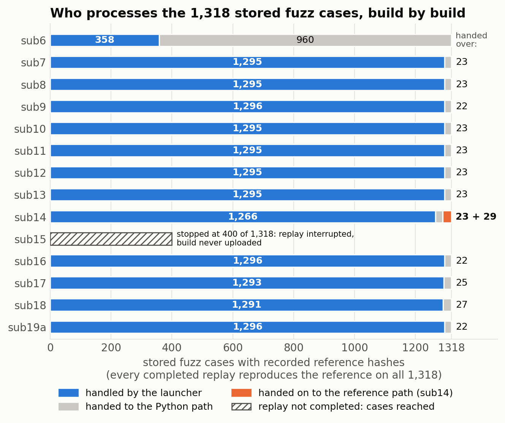

*Figure 18. The stored fuzz corpus by the layer that processed each case, for every build replayed in its full image: before the fix (sub6), after it (sub7), and up to sub19a. Every completed replay reproduces the recorded reference hashes on all 1,318 cases. The launcher hands 22 to 27 cases to the Python path (22 on sub9, sub16 and sub19a, 23 on sub7, sub8 and sub10 to sub13, 25 on sub17, 27 on sub18; §5.8); on sub14 a further 29 went on to the reference path. One replay was not completed: sub15 stopped at 400 cases. sub16's bar is from a replay repeated after its first one stopped at 200.*

### 6.5 Is the fixed cost ours? Four parallel studies

| Study | Main result | How we used it |
|---|---|---|
| Competition intelligence | The leading team's public image is a 1.2 MB single-layer image; several other top teams ship the same shape; Development scores only the 71 public units | Built and uploaded the same shape (sub7 scratch) |
| Container start-up engineering | Published warm `docker run` ≈ 0.55 s regardless of image size; the GPU runtime hook rescans the image's library directories (estimated 5–30 ms for a Python image) | Predicted a small gain; checked that our threads are never throttled by the CPU quota (they are not: `nr_throttled = 0`) |
| Literature | numpy's scalar `log` on AVX-512 hosts goes through a vector library and can differ from the C library by about 1 ulp | Supports the 16-ulp margin of our guard (§7.3); not a measurement |
| Code review | About 430 MB touched to write 22 MB; a `\u`-escape hole in the JSON parser; several crash-instead-of-fallback paths | sub8, sub9; the parser now decodes escapes as Python does |

The upload settled the first question: **+1.9%**, with a faster binary included. Image shape is not what separates us from the leaders.

### 6.6 A fix that would have broken six units

The review correctly pointed out that our parser kept `\uXXXX` escapes verbatim, so an escaped key could be silently misread. Our first fix refused such input. The page-fault survey that ran next reported only 59 of 65 units: six public scenarios contain such escapes in their free-text description, and in an image without the Python layer they would have failed outright. The escapes are now decoded to UTF-8 (surrogate pairs included; lone surrogates are declined).

### 6.7 Two reviews

Both were read-only: no builds, no changes to sources, no uploads. Their numbers are estimates from reading code and our measurement files.

| Review | Main results | How we used it |
|---|---|---|
| "Find a way to 240,000" | The ledger rule of §5.9, with the lines of the scorer that implement it; the two parameters of our score model cannot be separated from three scores; nothing in the image configuration can shorten the GPU hook or the container lifecycle | sub10, worth +2.9% |
| A deliberately harsh critique | The bound on the fixed cost (§5.6); a total upload cap, which it gave as 20; the laptop had been contradicted by the host; per-run overheads in our writer; its probabilities by the deadline were about 50% for 200,000, 18% for 210,000, 6% for 220,000 and 1–2% for 240,000 | The bound was verified and adopted. The cap is real but is 23, as the competition page shows (§8). Its overhead fixes went into sub13, which scored lower. 200,000 was passed two days later |

### 6.8 Three studies, two decision rounds and the organizers' statements

The three studies were read-only, like those of §6.7.

| Study | Main results | How we used it |
|---|---|---|
| Score model | No model built on laptop process time ranks our own builds (§5.6) | We stopped projecting scores from laptop time, after three projections had missed |
| Public code of other teams | None from the leading teams. Two public engines by other teams, both with 4-ary heaps, static binaries and scratch images. The notes of one say that numpy 1.26's `log` on AVX-512 processors is a vendor vector library and differs from the C library on about 27% of inputs. The platform's container flags, from the toolkit's runtime document. The output folder is a bind mount of a host directory | Our design choices are the common ones. The `log` note bears on §7.3 |
| Engine review (nothing compiled) | Nine candidate changes, ranked, with estimated gains; order receipts are 37.6% of the largest unit's events and 47.7% of the deep-book unit's | Five went into sub18: wakeup rings (its estimate: 7–9% of simulation-thread time), own orders only for market makers (about 3%), one-row trace buckets (3–4%), no record for a skipped ledger (part of 4–6%), blocked queues as sorted vectors (0.6% on the largest unit, 6–7% on the deep-book unit). Not implemented: a bottom-up heap pop, noise-trader draws on the helper thread, prefetching, and handling order receipts outside the event queue (its estimate: 20–28% more, 12–20 hours of work, high risk) |

The review's estimates were not checked one by one. What was measured for the five changes together, plus the compact trace row, is in §5.11: 7.4% fewer instructions and 733 against 830–850 million cycles on the largest unit, one thread.

| Decision round | State | Answers | What happened |
|---|---|---|---|
| 6 | Before sub17 was uploaded | Value of uploading sub17 with writer threads first 2.07, the engine change alone first 1.64, waiting for per-unit data 1.01, the helper disabled 0.50; as a choice: engine change alone first 0.44, wait 0.41. Reachable: 200,000 0.67, 210,000 0.44, 230,000 0.18. Next work: the event queue 0.67 | Both sub17 variants were uploaded five minutes apart. The event-queue work became sub18 |
| 7 | Both sub17 variants uploaded; the score of the one without writer threads not yet in | Upload sub18 when validated, then start the high-risk restructuring 0.74; attempt the restructuring 0.34; sub18 beats sub16 0.80; reachable: 220,000 0.55, 230,000 0.24; candidate for the Final: the best-scoring build 0.69 | sub18 was uploaded only with the helper off (193,962), so "sub18 beats sub16" was not tested as posed. The restructuring was not attempted |

Statements by the organizers that we found in their public issue tracker, beyond those used in §4.2 and §5.9: submissions should keep accepting the GPU device the unit attaches and not set `NVIDIA_VISIBLE_DEVICES` in the image (we never set it); the Final limits are 300 s per run, five runs per unit (a warm-up and four counted), 4 CPUs, 16 GiB and 24 hours for the whole run; the Final rehearsal was postponed; an upload that reads "Submitting" for well over an hour is usually held for a team-claim problem and still consumes an attempt (one of ours read "Submitting" for a while after a later upload had finished, then finished normally). A calibration post announced by the organizers (a minimal process and the deterministic baseline, each timed both from container creation to removal and from start to finish) had not been published at the time of writing. Two later commits to their repository changed documentation only: images must be anonymously pullable, and the Final takes one upload per team at any time in a window of about two weeks after Development closes, during which the code may still change; a Final upload that ends as failed does not use the attempt.

---

## 7. Experiments, hypotheses and their outcomes

### 7.1 Selected experiments

| Experiment | Result | Decision |
|---|---|---|
| Dense price-indexed order book | 0.57–1.09× | Reverted |
| Profile-guided optimisation, first attempt (wall-clock A/B on the shared library) | −9% to +27% | Inconclusive; not adopted then |
| `-march=x86-64-v3` | +3.7% | Too small |
| Cold vs warm run in one process | Best-of-N still far from the old target | Dropped when the rule changed |
| Arrow parallel column encoding | Identical bytes; speed within noise | Kept, harmless |
| Static link against OpenSSL | Link failure (zstd/zlib dependencies) | Wrote SHA-256 ourselves |
| Own Parquet writer | 4/4, then 65/65 tables identical | Adopted (sub5) |
| Parallel output chains, no teardown before exit | `gb_mega` 563 → 530 ms | Adopted |
| Delta encoding | Files 5.6× smaller; about 4% less process time | Adopted (sub6) |
| Asynchronous pre-faulting | No gain in interleaved A/B (inside noise) | Off by default |
| Two-thread trace merge | No gain in interleaved A/B (inside noise) | Off by default |
| Scratch image | +1.9% score | Kept for Development |
| No zero-fill, partial pre-fault, huge pages | −48% page faults, −13% process time | Adopted (sub8) |
| Index-based trace output | −34% further page faults | Built (sub9); gained nothing on the host |
| No ledger on the six units that need none | −11.9% process time on them; +2.9% score | Adopted (sub10) |
| Profile-guided `-O3` build of the static launcher | −1.9% on six units | Adopted (sub11) |
| Huge pages and up-front population switched off | About +70% on the largest unit on the laptop; +0.2% score | Shipped off from sub11 |
| One fresh container per run | 2–5× slower than warm; spread as large as the mean | Local timing demoted to counting work |
| Streamed writer, pooled threads, thread cap, allocator settings | −6% on the laptop (inside the spread); −2.6% score | Not built on further |
| Trace kept in final order during the run | −6.8% on seven units; peak memory −17%; score +7.6% (sub16 against sub11) | Adopted; the basis of every later build |
| Writer threads during the run | Laptop, unit folders: −14%, +4% and +12% in three comparisons; inputs in memory: −17% process time over 71 units. Host: +1.6% (sub17) | Kept as a switch, off by default |
| Inputs on an in-memory mount for timing | The Windows-backed mount had added 10–20 ms to every run | Adopted for all later timing (`lab/true_p.py`) |
| Branch-free heap step | Largest unit: instructions −5%, branch misses 11.59 → 4.93–5.12 million, cycles −8 to −17% | Adopted (sub17) |
| Heap padded with sentinels | Instructions −2.0%; cycles within noise, slightly worse on one unit | Reverted |
| Helper thread started at engine creation, never abandoned | Not measured locally before upload; sub17 scored 3.6% below sub16 | Withdrawn in sub19a; mechanism not established |
| Latency helper thread off | Laptop: simulation phase of the largest unit 257–298 ms against 211–220 ms. Host: −8.6% (sub16 binary) | Helper stays on |
| Compact trace row, less bookkeeping, wakeup rings, sorted blocked queues | Largest unit, one thread: instructions −7.4%, cycles 830–850 → 733 million. Host, with the helper off: +4.4% over sub16 (heap step included) | Adopted (sub18) |
| Helper that sleeps while its ring is full | Slower than spinning with a ring of 2¹³ values; with 2¹⁵ faster on two units and about equal on a third | In sub18 with a ring of 2¹⁵; no host score; not in sub19a |
| Eight binary and helper combinations timed on a loaded laptop | Two rounds of one binary differed by up to 45% | Discarded |

### 7.2 Hypothesis register (abridged)

| Hypothesis | Test | Outcome |
|---|---|---|
| A native reimplementation can be bit-exact | 65 + 30 + fuzz | **Confirmed on everything tested** |
| Trace rows arrive in time order, so only equal-time runs need sorting | Identity + a monotonicity check kept in the code | **Confirmed for the public scenarios**; refuted for negative latencies (below) |
| Page faults are a large share of the loop | Profile, then A/B | **Confirmed** |
| A dense order book is faster | A/B | **Refuted** |
| Blocked queues give exactly the reference's dispatch order | Argument, independent derivation, identity | **Confirmed on everything tested** |
| The Development board still ranks loop speed | Organizer post, README, board | **Refuted** (the rule changed) |
| The verifier accepts any valid Parquet file with the same table | Scorer source; official harness | **Confirmed for the public harness** |
| Our gap to the leaders is mostly our own process time | Phase timing; then the sub5 score | **Partly confirmed**: it closed 36% of the gap |
| sub5 will score 185–220K | Upload | **Refuted, narrowly** (181,496) |
| A two-parameter overhead model describes the board | Fit | **Refuted as stated** (ceiling below the leader) |
| Output size costs container time on the scoring host | sub7 has 5.6× smaller files than sub5 | **Not supported** (+1.9% in total) |
| Image shape is worth more than 5% | Upload of the scratch image | **Refuted** (+1.9%) |
| sub6 is slower than sub5 | Two further interleaved runs | **Refuted** (the slow run was noise) |
| Memory handling dominates the remaining process time | Resource counters; then the sub9 score | **Confirmed on the laptop; refuted for the scoring host** (−0.8%) |
| The scorer does not need a ledger where the card says so | Scorer source; README; the sub10 score | **Confirmed** (+2.9%) |
| Huge pages and up-front population cost, or save, time on the host | sub11 with both switched off | **Neither**: +0.2%, too small to interpret and bundled with a compiler change |
| Warm best-of-N timing predicts the direction of a host score | Nine steps (§5.9, §5.10) | **Refuted**: opposite signs in four of nine, among them the memory work of sub9, sub13 and sub17; held for removed work and for the helper thread |
| The fixed container cost is about 0.55 s | The leader's score | **Refuted**: at most 0.47 s |
| Removing per-run overheads (thread creation, allocation churn) raises the score | sub13 | **Not supported**: the build that removed them scored 2.6% lower, for reasons not isolated |
| A streaming writer loses on the host (our reading of sub13) | sub17 with and without writer threads during the run | **Not supported**: +1.6% with them. sub13 remains unexplained |
| Trace rows always arrive in time order | Fuzz replay of sub14 | **Refuted** for negative latencies (29 stored cases); exact handling restored in sub15 |
| Building the trace in order during the run raises the score | sub16 against sub11 | **Confirmed** (+7.6%), with two smaller changes in the same step |
| The latency helper thread costs more on the host than it saves (held at 60 to 40) | The sub16 binary with the helper off | **Refuted**: 185,818 against 203,394 |
| "Adding or strengthening a thread loses; removing threads wins" | The same upload; sub17 with writer threads on | **Refuted** twice |
| Writer threads during the run lose on the host | sub17 with them (199,285) and without (196,165) | **Refuted** (+1.6%); we had announced the opposite from the first of the two scores |
| A helper started at engine creation is at least as good as one woken at the start of the run | sub17 against sub16, with the two helper-off uploads to exclude the engine | **Not settled**: sub17 scored 3.6% lower, but sub19a, with the old start-up restored under sub18's engine, also scored below sub16 (−2.1%); the start-up change is not isolated |
| sub17's helper was not working at all on the host | sub18 with the helper off | **Undecided**: the upload showed only that the engine is better |
| sub18's engine is faster on the host than sub16's | Both with the helper off | **Confirmed** (+4.4%) at that setting; not tested with the helper on |
| sub17 will score 197–205K; later 205–209K without writer threads and 209–219K with them | Uploads | **Refuted**: 196,165 and 199,285 |
| A model "fixed cost + *k* × laptop process time" can rank our builds | Fit to six scores | **Refuted** (rms residual 3.2%, largest 6.3%) |
| Development scores carry noise of about 1.6% | Organizers' statement; another team's report of 0.1% | **Contradicted by those statements**; not verified by a repeated upload of ours |
| 240,000 is reachable for us | Model; the decision model put it at 0.31 and 230,000 at 0.18 and 0.24; an independent review put 240,000 at 1–2%; from sub16's score 230,000 needs 41–68% less process time on the host | **Open; very doubtful** |

### 7.3 The `log` problem

A log-normal latency model needs μ = log(mean). The reference computes it with numpy. numpy's scalar `log` may be a vectorised routine on AVX-512 hardware, differing from the C library in the last bits. Rather than embed code we could not test, the launcher computes μ with the C library and flags any draw whose rounded result could change if μ moved by 16 ulps; a flagged run is handed to the Python layer, which uses numpy on the same host. The flag fired on 0 of 71 public units and on 4 of 1,318 fuzz cases in a launcher-only pass; with the helper thread drawing ahead it can also fire for a draw the run never uses (§5.8). The 16-ulp margin is an assumption supported by documentation (differences of about 1 ulp), not by a run on such hardware. Another team's public notes state that on AVX-512 processors numpy 1.26's `log` differs from the C library on about 27% of inputs; we have not reproduced that figure. What we can say is that every one of our scored runs passed the correctness gates on the host, on units none of which raises the flag.

---

## 8. What went wrong

We record these because they shaped the result as much as the successes.

- **We optimised the wrong component for days.** After the rule change we shipped sub4 without profiling the whole process. Our own notes already said that encoding dominated small units.
- **We read the timing harness late.** The launch command and the fact that every unit attaches a GPU were in the public repository; we inferred the fixed cost by curve fitting first.
- **Three early predictions missed.** sub5 scored just under our predicted range; the fitted ceiling is contradicted by the leader; the image-shape hypothesis, which we rated the main hope, yielded 1.9%.
- **The decision model was sometimes wrong.** It answered that small units drive the mean (the arithmetic says large ones do) and it preferred the upload that produced 1.9%. It was right that shipping and reading the result beat further speculation.
- **The fuzz re-check was deferred across three submissions.** When finally run it passed, and exposed the 73% decline rate.
- **Tooling.** Docker died four times during one reproduction run (memory). Patches sent through shell here-documents silently turned `\n` in string literals into line breaks, five times. One benchmark measured a stale image because a build failure was hidden behind a pipe. A file size was once written into a draft from memory and was wrong.
- **We optimised against the wrong measurement for three days.** Warm repeated runs on a laptop were treated as a proxy for a host that runs each unit once, cold. The host contradicted the proxy twice before we tested the proxy itself (§5.9).
- **We missed a rule that the README states.** Six heavy units need no message ledger. A read-only review found it; it was worth more than the two preceding days of memory work.
- **We planned with the wrong upload budget, twice.** First with none; then with a total of 20 read from a toolkit document, where the competition page allows 23 per person. That was corrected. One upload (sub11) bundled a compiler change with a memory-mode change and so answered neither question cleanly.
- **We uploaded sub13 without timing it against its predecessor**, on the same day we had resolved to bundle fewer changes. It scored 2.6% lower and we cannot say why.
- **We dropped a slow path we believed unused.** The comment in our own code said out-of-order trace rows had never been observed; the fuzz corpus contains 29 cases of it. The full image hid the failure behind its fallback.
- **We shipped a speculative change inside a measured one.** sub17's new helper start-up was added "as a safeguard" with no evidence from the host, together with a heap change whose counters we had. The build scored 3.6% below sub16, and two uploads were spent before the cause was isolated to the helper; its mechanism is still a guess (§5.10).
- **We gave three score projections from laptop timing, all wrong,** after the model behind them had already been shown not to fit. The team planned around numbers that meant nothing.
- **We announced "writer threads lose" from one score** whose comparison score had not arrived. It was corrected an hour later, by the opposite result.
- **We read a rule out of nine scores ("threads lose"), dismissed the one counterexample, and bet an upload on it** at 60 to 40. The helper-off upload scored 185,818. It turned out to be the most informative upload of the project, which was not why it was made.
- **Our laptop figures had included a slow input mount since sub4.** We had never traced a run. Every earlier comparison carried 10–20 ms per run of it (§5.11).
- **We never obtained per-unit results from the host.** They need the team's login on the platform; this was asked for several times and not done. The fixed cost per container is therefore still unknown.
- **Process slips.** A background validation was believed killed by a tool timeout and was restarted while it was still running, so two validations ran at once and a log line was removed by hand from a file the first was still writing. A detached build was reported as running when it had never started, and this was not checked for ten minutes. A finished log of the previous image was read as the new build's result, because the file name was the same; identical timing figures gave it away, and the file was renamed. The first per-thread profile attributed the helper's samples to the simulation thread, because the thread had been chosen by sample count and not by id; it was redone.
- **A second independent review**, asked to be harsh, called the engineering "three days of optimisation against a proxy that the scoring host had already contradicted". We agree.
- **An independent review rated the work** 7.5/10 for correctness engineering, 5.5/10 for whole-process performance and 5/10 for measurement discipline. We think that is fair.

---

## 9. Limitations

**Correctness**

- sub5 and later are **not byte-identical** to the reference Parquet files. They read back as identical tables and pass the public verifier. A sealed check comparing bytes or hashes with the reference would reject every unit. We found no such check in anything published; the Final scorer is not public.
- The files were read only with pyarrow 15.0.2 and pandas 1.5.3.
- Writer paths never exercised by our data: dictionaries above 16 entries, an empty ledger, an all-null column, 64-bit-wide delta blocks.
- Exactness is established on the public scenarios and the fuzz corpus. Sealed scenarios may combine features differently.
- The `log` margin (§7.3) is unverified by any test of ours on AVX-512 hardware; the Final host is such a machine. By the organizers' statement it is also the Development host, where every one of our scored runs passed, on units that do not raise the flag.
- The scratch image has no fallback layer. A unit the launcher declines fails and scores zero. This is safe for Development (all 71 public units are handled in every run made) and a real decision for the Final, undecided at the time of writing: a scratch image, or a full image with the exact Python fallback. From sub18 the launcher has one more reason to decline (a value too wide for the compact trace row), and the look-ahead effect of §5.8 can add declined cases that depend on the helper's ring size.
- **The fuzz replay of the best-scoring image, sub16, is not part of its validation log**: there it stopped at 200 of 1,318 on a Docker failure. A separate replay on the same image completed with 1,318 of 1,318 (`lab/bench/val_sub16/fuzz.log`); that the image tag had not changed in between rests on the image's creation time, not on a recorded digest.
- The fix for the look-ahead effect is in the source only, in no image, and has not been fuzz-replayed.
- We never ran the scratch image on a host with a GPU runtime before uploading; it worked.

**Performance**

- No measurement on the scoring host other than its scores, and none on any native Linux machine. Absolute times are from Docker Desktop on a swapping laptop, and until late in the work they included a slow input mount (§5.11). Ratios of laptop timings proved unreliable wherever memory or threads were involved, and differ between sessions; only counts and host scores are firm.
- Every Development score is a single run. That the host is dedicated and repeatable to about 0.1% rests on the organizers' statement and on another team's report. Our own only repeated upload (sub4) differed by 1.6%, and we have not repeated one since. Each comparison in §5.10 is therefore one run against one run.
- The platform withholds program logs and we did not obtain per-unit results, so we cannot say which units cost us most, and the fixed cost per container is unknown beyond the bound *c* ≤ 0.47 s.
- There is no score model. The one of §5.6 is wrong, and no replacement built on laptop time fits (§5.6).
- The step from sub11 to sub16 is not strictly one change: besides the trace assembly it carries regrouped agent fields and allocator settings. sub11's own score bundles two changes and cannot be attributed.
- That sub17's lower score is due to its helper start-up is an inference by elimination from two other uploads. Its mechanism is a guess. The build meant to test it directly, sub19a, scored below sub16 as well, which weakens the inference without replacing it.
- sub18 was scored only with the helper off. Its helper, which sleeps while its ring is full, has no host score. The only scored build that combines sub18's engine with a working helper is sub19a, which uses sub16's helper code.
- The value of the helper thread (9.5%) and of writer threads (1.6%) was measured on the 71 public units of the Development roster, on one binary each.
- Hardware counters were taken on one thread on a laptop processor. They say nothing about how threads are placed or share a core, which is where the host surprised us most.
- Wall-clock effects below about 5% are unresolved on our rig (asynchronous pre-fault, two-thread merge, the first profile-guided attempt).
- sub14 and sub15 were never uploaded, and sub15's full validation was never completed.
- sub13's lower score is unexplained. It bundled five changes.
- The number of fuzz cases the launcher hands to the Python path was 22 on sub9, sub16 and sub19a, 23 on sub7, sub8 and sub10 to sub14 (on sub14 a further 29 went on to the reference path), 25 on sub17 and 27 on sub18. The outputs are correct in every case. The explanation given in §5.8 for the last two has not been confirmed by a targeted test, and the single case on sub9 has not been traced.
- A negative latency is handled exactly from sub15, on the evidence of 29 fuzz cases compared with an earlier build. No public unit has one.
- The organizers' calibration measurements, which would separate the fixed cost from process time, had not been published at the time of writing.

**Scope**

- This is a Development-phase report. Nothing here is a Final result. The Final, as announced, takes one submission per team, uploaded at any time in a window of about two weeks after Development closes, and times it on the same machine, on sealed units, five runs per unit; it had not been run at the time of writing, and one of our 23 Development uploads remained.

---

## 10. Reproducibility

### 10.1 What is exactly reproducible

| Quantity | Reproducible? |
|---|---|
| Table contents of both output files; event and message counts | Exactly |
| Output bytes, sub1–sub4 and Python layers | Exactly (with the `log` caveat on AVX-512 hosts) |
| Output bytes, sub5 onward | Exactly between runs of the same image (65/65 units, 3 runs); different from the reference by design |
| Verdicts of the identity checks and of the official harness | Exactly |
| Instructions per run on one thread (`perf stat`, user mode) | To ±0.00% on our machine; branch misses to under 0.5%, cycles to 0.5–2% |
| Instructions per event | Closely |
| Times, events/s, scores | Machine- and host-dependent |
| Image digest after a rebuild | No |

### 10.2 Published images

| Image | Tag | Digest | Development score |
|---|---|---|---:|
| Baseline (unmodified ABIDES) | `dev` | `sha256:c4f8a635794ebeb4026e8bc2977b3fdd9feef830def78025ce4f744461c77996` | |
| sub1 | | `sha256:8d4db7f43ea848770c7d99a6b0b14089b3b5ee72d88a95fdf8208414e030fe7b` | old rule |
| sub2 | | `sha256:81e6fa40372a3a4e076a3a5e0adc0341b8c0263c288e8d3a5fe3dae32acc2d7a` | old rule |
| sub3 | `native-v3` | `sha256:67e3086d427a68a9ba1c390811dafbc93f11b6ed42d228d5312c1a91c0fc60c7` | never uploaded |
| sub4 | `native-v4` | `sha256:697ae5de6d95b1fce2bd467375060a10f4f343a04a00d00a989b38e5869d85c7` | 153,825 |
| sub5 | `native-v5` | `sha256:eb90d781431939ce0357290851f4b08f178dfd654d5de2e53feaefa4f117ab06` | 181,496 |
| sub7 (scratch) | `native-v7s` | `sha256:2b97366d097cf6a68e6aefb3a148940ae1517de55c6945d7dc43f64e6b3e4cf0` | 184,858 |
| sub9 (scratch) | `native-v9s` | `sha256:9e8206c3567c1f54e43f74a28a302a06971d8de99ed704b7e6bdb1ace61d3a57` | 183,420 |
| sub10 (scratch) | `native-v10s` | `sha256:3b27783ef58421aba303d1897564e7b59df06f86d89e70e982d2c5b34254a441` | 188,687 |
| sub11 (scratch, memory switches off) | `native-v11m` | `sha256:47c37844beb88e6a36043a9ef25bf7ad248ec41ae299fc8f8472136d7cfe8128` | 189,018 |
| sub13 (scratch, memory switches off) | `native-v13m` | `sha256:1ca74d1cd2c8dbc63cd2db495b9d1fc5885e3206f8aa43c87bac5db3784f86f0` | 184,047 |
| sub16 (scratch, memory switches off) | `native-v16m` | `sha256:96856191063e0cefe726d5c9a0d8bbea049ef52182e6a3308fe174aadfcdbd83` | **203,394** |
| sub17 (scratch, writer threads off) | `native-v17n` | `sha256:6d1a0d8fdfce8001fe4d7722009bfa9e7b54f15b458ff68bdb86a1290e03c192` | 196,165 |
| sub17 (scratch, writer threads on) | `native-v17t` | `sha256:998c2f45c2eac81bb50c14679694a1ca090e43534d0c6bbce9f8b208bb81ecd8` | 199,285 |
| sub16 binary, helper thread off | `native-v16-helper-off` | `sha256:31cb73d3789e38dba5f47f6c6e91068ecd216f45656fa1dd4fc405bbf8788f5c` | 185,818 |
| sub18 binary, helper thread off | `native-v18-helper-off` | `sha256:b437b60816126789b60d9faa5c0c0a16b0fdd7d7e851d5b4711140ff5feaf6ce` | 193,962 |
| sub18 binary, sleeping helper on | `native-v18-helper-sleeping` | `sha256:2f9c4d39a04390cb7700dfc8730746efabe3cf9bbbe64c26846235fcfae38ea7` | never uploaded |
| sub19a (scratch) | `native-v19a` | `sha256:abca67f17b3558eedca6e44ec2e437ec5b9ff7ccb3121c4ad2c4879f53dcf434` | 199,058 |

All under `docker.io/slashalpha/agenthon-track3`. sub6, sub8, sub12, sub14 and sub15 were built and tested locally and never pushed; sub19b existed only as sources and a local full image at the time of writing. Sources are kept as snapshots (`lab/sub6_src/`, `lab/bench/*_sub8.*`, `*_sub11.*`, `*_sub13.*`, `*_sub14.*`, `*_sub15.*`, `engine_sub17.cpp`, `engine_sub18.cpp`, `engine_sub19a.cpp`, `engine_sub19b.cpp`, `launcher_sub17.cpp`, `launcher_sub18.cpp`). The scratch images contain the launcher alone; each was built from a full image of the same number whose binary is byte-identical. The two helper-off images add one environment setting to a scratch image without adding a layer (`lab/bench/Dockerfile.nohelper`). The engine source in the deposit is sub18's plus the look-ahead fix of §5.8, which is in no image.

### 10.3 Commands

```bash
# correctness of a byte-identical image (sub1-sub4): baseline, candidate, hash comparison, batch, harness
IMAGE=slashalpha/agenthon-track3@sha256:697ae5de… bash repro/repro.sh all

# full validation of a table-identical image (sub5 onward):
# tables (65), repeat-run bytes, batch under runtime restrictions, official regression, fuzz corpus
bash lab/validate_image.sh <local tag>

# replay of the 1,318 stored fuzz cases against recorded reference hashes
docker run --rm -v "$PWD/native/fuzz:/fz:ro" <image> python /fz/recheck_stored.py /fz

# fast checks before the long validation: tables, no-ledger units, byte stability, negative-latency cases
bash lab/quick_checks.sh <local tag>

# the six units that need no message ledger, mounted the way the harness mounts a unit
bash lab/check_skip.sh <local tag>

# warm measurements of several builds on the 65 units (time, page faults, peak memory, output size)
bash lab/measure_builds.sh 2 3 sub9 sub10 sub11:off sub13:off sub14:off sub15:off

# one fresh container per run, as the scoring host runs a unit
bash lab/cold_runs.sh <local tag> 4 t3-mr-deep-book-state-size

# --- later tools; these run inside the development container (image t3-native-perf,
# --- with perf, and the native sources, unit folders and lab tools mounted at /native, /units, /lab)

# the image's profile-guided launcher build, without building an image
bash /lab/build_pgo_dev.sh <output binary>

# byte comparison of two launcher binaries on the 65 single units; optional settings for the new one
bash /lab/cmp_bins.sh <reference binary> <new binary> T3_LAT_THREAD=0

# table comparison of two binaries on all 71 units, for use when the writer mode differs
python /lab/cmp_tables.py <reference binary> <new binary> T3_TRAIL=1

# process time per unit with the inputs copied to an in-memory mount first
python /lab/true_p.py <binary> <out.json> 5 T3_TRAIL=0

# counters on one thread
T3_LAT_THREAD=0 T3_TRAIL=0 perf stat -e cycles:u,instructions:u,branch-misses:u \
    <binary> simulate --config <scenario.json> --out <dir>/trace.parquet

# --- on the host
# build the full image and run the whole validation; build one from an engine snapshot;
# run only the two long stages (official regression, fuzz replay) of a validation
bash lab/build_validate.sh <tag>
bash lab/build_variant.sh <tag> lab/bench/engine_sub19a.cpp
bash lab/validate_rest.sh <tag>

# figures of this report
python paper/make_figures.py
```

`docs/REPORT.md` in the same deposit is the full laboratory record (every experiment, including failed attempts, with exact numbers and file locations); this report is its summary.

### 10.4 Environment

Windows 11 Home; AMD Ryzen 5 5500U (SHA instructions, no AVX-512); 5.99 GB RAM; Docker Desktop 29.7.2 on WSL2 (kernel 6.6.87.2), VM memory 2.76 GiB. Images: `python:3.11-slim`, numpy 1.26.4, pandas 1.5.3, pyarrow 15.0.2; g++ 14; flags `-O2 -std=c++17 -ffp-contract=off -pthread` (`-static` for the launcher from sub5; `-O3` with profile feedback for the launcher from sub11). Organizer sources: `track3-simulation-public` at `4cc7882` and `bffb572`; toolkit tags v2.3.1 and v2.5.1. The organizers' repository had two later commits when this was written, both to documentation (§6.8).

---

## 11. Discussion

**What the rule change did.** A benchmark that divides by a self-reported inner-loop time rewards the inner loop and nothing else; it also rewards choosing what to call the inner loop. Dividing by whole-container time removes that freedom and rewards the complete program, but it also puts a constant into every denominator: at most 0.47 s per unit, by the bound of §5.6, and we cannot say how much less. For the many small units that constant is most of the measured time whatever its exact value. The ranking among submissions whose process time is already small is then decided by a modest part of the denominator. Whether run-to-run variation also matters depends on the host: we saw 1.6% between two identical uploads early on, and the organizers and another team have since described a dedicated machine repeatable to about 0.1%. If that holds, differences of one or two percent between uploads are real, and the limit on what a team can learn becomes the number of uploads, 23 in our case.

**What the measurements taught.** In order of discovery: a laptop proxy that was wrong in sign for four of nine steps; a fitted cost model that the leader's score refuted and whose successors could not rank our own builds; and, once the host was known to be quiet, the fact that an upload changing one setting is an experiment and anything else is not. The five uploads cost about a fifth of our budget and are the most informative part of the record: that the helper thread is worth 9.5%, that the engine work of sub17 and sub18 was worth 4.4% at an equal helper setting, that writer threads gain 1.6% where we had said they lose, and that a change nobody had measured had cost 3.6%. They also showed how quickly we generalise from too little. Two of those results reversed statements we had made within hours, one from a single score and one from a pattern in nine. The uncomfortable part is that the discipline was already written down: we had already resolved to bundle fewer changes per upload, and sub17 still shipped a measured change together with an unmeasured one.

**What we would do differently.** Profile the ranked quantity end to end before touching anything; read the measuring code and the scorer first, including what the scorer does not read; trace one run on the measuring machine before trusting its clock; use counters for engine work and uploads for everything involving threads, memory or the container; make every upload differ from a scored one in a single setting, with the pairs planned against the upload budget from the first day; say nothing about a score until its comparison score has arrived; obtain per-unit results; and run the cheap, boring validation (the fuzz replay, and the count of who handled each case) before the interesting optimisation.

**What transfers.** Four things seem general. A bit-exact port of a Python simulator is feasible if exactness is treated as a gate with layered fallbacks rather than as a property to be hoped for. Serialization can dominate simulation by an order of magnitude once the simulator is native, and after that the order in which results are produced can matter more than how fast they are encoded: building the trace in its final order was worth more than every encoder change after the first. Counts (page faults, instructions, branch misses, bytes written) are repeatable on a noisy machine where wall-clock time is not, but they are only as good as the cost model behind them: we cut page faults by two thirds and the scoring host returned nothing for it, while instructions and output removed outright did pay. And how a program's threads are started and placed on the measuring machine can be worth more than the engine work itself, in either direction, and could not be seen from our own machine.

---

## 12. Related work and sources

*These sources were identified during the study by automated literature and web searches. They are listed for context; the team should verify each reference before publication.*

- Byrd, Hybinette, Balch. *ABIDES: Towards High-Fidelity Multi-Agent Market Simulation* (the simulator reproduced here), and the `abides-jpmc-public` repository.
- Frey et al. *JAX-LOB: A GPU-Accelerated Limit Order Book Simulator*, arXiv:2308.13289 — speed through batching across books, which exact dispatch order rules out.
- Belcak, Calliess, Zohren. *Fast Agent-Based Simulation Framework … (MAXE)*, arXiv:2008.07871.
- Larkin, Sen, Tarjan. *A Back-to-Basics Empirical Study of Priority Queues*, arXiv:1403.0252 — implicit d-ary heaps at small queue sizes.
- Lemire, Boytsov. *Decoding billions of integers per second through vectorization*, arXiv:1209.2137 — bit-packing kernels.
- Apache Parquet format specification, *Encodings* (DELTA_BINARY_PACKED, RLE/bit-packed hybrid).
- numpy issues #22904 and #23523 on `log`/`exp` differences between AVX-512 and other builds.
- Oakes et al. *SOCK: Rapid Task Provisioning with Serverless-Optimized Containers*, USENIX ATC 2018, and later container start-up measurements.
- Agenthon 2026 organizers. `track3-simulation-public` (rules, harness, scenarios) and `Agenthon2026-public` (toolkit), including the scoring-change announcement.

---

## Statement on the use of AI tools

AI tools were used in this work, including for running the experiments, analysing the results and producing the figures. All numerical results come from runs recorded in the accompanying laboratory record; statements that are modelled, estimated or unverified are marked as such. The author takes responsibility for the content.

## Data and code availability

The deposit contains this report, its figures and the script that generates them, the full laboratory record (`docs/REPORT.md`), the reproduction kit (`repro/`), the validation and benchmark tools, the fuzz corpus with recorded reference hashes, and the measurement files under `lab/bench/`. The submission images are public at the digests in §10.2.
